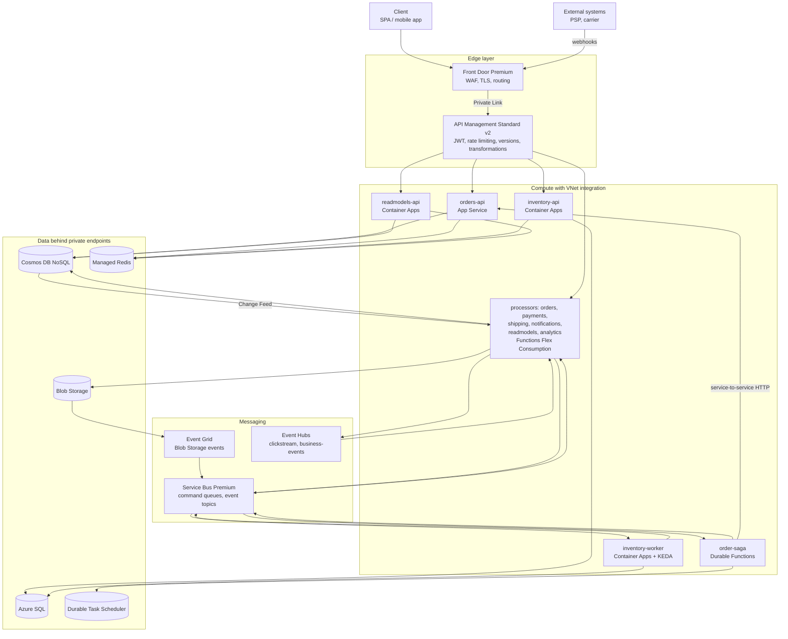
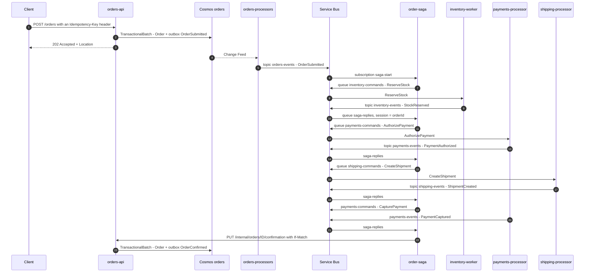

# ShopFlow — architecture document

| | |
|---|---|
| **Status** | Accepted; the architecture reference for the repository |
| **Date** | 2026-11-14 (language switched to English on 2026-11-22) |
| **Scope** | Target architecture, the list of services, Azure resources and messaging entities |
| **Companion document** | [01-repository-plan.md](01-repository-plan.md) — directory tree, technology stack, stages |

> How to read it: sections 4–7 are "what we build", sections 8–11 are "what it runs on and how we secure it",
> section 15 lists the decisions taken up front, with their alternatives.

---

## 1. Goal and assumptions

ShopFlow is an e-commerce platform built as a set of independently deployed services in one monorepo. The repository is
meant to mirror a production enterprise project on Azure and to be used for learning by reading code.

**Assumptions that follow from this goal:**

- Realism and completeness matter more than being able to run it locally. The code must compile, but there is no
  guarantee of a working local environment (some services have no emulator, e.g. API Management or Front Door).
- Every Azure service appears where it is justified, and every one has its ADR. Where two services solve a similar
  problem (e.g. two outbox variants), both are shown on purpose, but in different contexts, where each is the natural choice.
- Code, identifiers, comments (`// AZURE:` and `// WHY:`) and documentation are in English.

## 2. Architectural principles

These principles settle design disputes later in the document.

1. **One bounded context = one data owner.** No service reads another service's database.
   Integration happens only through versioned contracts (messages or APIs).
2. **Asynchronous by default.** Synchronous HTTP appears at the edge (client → API) and in two deliberately chosen
   service-to-service places (section 9.3).
3. **At-least-once everywhere.** Every broker in Azure can deliver a message more than once. That is why publishing
   goes through an outbox, and every consumer is idempotent (inbox).
4. **Identity instead of secrets.** Managed identities for all Azure services, local authentication (keys, SAS, SQL
   passwords) disabled at the resource level. Key Vault holds only third-party secrets (PSP, carrier).
5. **Private by default.** Data stores and brokers have no public endpoint. Front Door is the only public entry to the system.
6. **The same topology in every environment.** dev, test and prod differ in size, redundancy and retention, but not in
   network shape or identity model.
7. **Build once, deploy many.** One artifact (image, zip package) goes through all environments; only the configuration differs.

## 3. System view

Full C4 diagrams: [context](c4-context.md), [containers](c4-container.md), [components](c4-component-orders.md)
(Orders, the saga, Inventory, Payments). Patterns catalog: [patterns.md](patterns.md). Step-by-step scenarios:
[docs/walkthroughs](../walkthroughs/README.md).

## 4. Bounded contexts and deployable units

Seven bounded contexts translate into twelve deployable units, because some contexts have separately scaled APIs and
message processors.

| # | Unit | Context | Hosting | Why this hosting |
|---|---|---|---|---|
| 1 | `orders-api` | Orders | App Service (Linux, Premium v3) | Steady HTTP traffic, predictable latency required. Slots give zero-downtime deployment with a swap and instant rollback. |
| 2 | `orders-processors` | Orders | Functions Flex Consumption | Outbox relay on the Change Feed and the consumer of shipping events. Event-driven work, scale to zero. |
| 3 | `order-saga` | Orders (process manager) | Functions Flex Consumption + Durable Functions | Durable orchestration with timers and compensations without writing a custom state machine. |
| 4 | `inventory-api` | Inventory + Catalog | Container Apps | The catalog has highly variable traffic (campaigns); scaling by the number of concurrent HTTP requests. |
| 5 | `inventory-worker` | Inventory | Container Apps + KEDA | A command queue consumer scaled by queue length, a long-running process with a SQL connection pool. |
| 6 | `payments-processor` | Payments | Functions Flex Consumption | Payment commands in sessions, the PSP webhook, invoice generation. |
| 7 | `shipping-processor` | Shipping | Functions Flex Consumption | Shipping commands, the carrier webhook, labels in Blob Storage. |
| 8 | `notifications-processor` | Notifications | Functions Flex Consumption | A pure reaction to events, spiky traffic. |
| 9 | `readmodels-projections` | Customer Read Models | Functions Flex Consumption | CQRS projections built from events. |
| 10 | `readmodels-api` | Customer Read Models | Container Apps | The CQRS read side, scaled independently of the write side. |
| 11 | `analytics-processor` | Analytics | Functions Flex Consumption | Clickstream ingestion, the business event forwarder, streaming aggregations. |
| 12 | `inventory-migrations` | Inventory | Container Apps Job, started by the pipeline | EF Core migrations as a bundle executed in the VNet; the database has no public endpoint. |

**Boundaries worth noticing:**

- **The Catalog is part of Inventory.** The list of contexts in the requirements does not include a separate Catalog,
  and the product catalog and stock levels share the SQL database and the `Product/Sku` model. In a larger organization
  these would be two contexts; the trade-off is described in [ADR-0006](../adr/0006-cosmos-or-sql-per-context.md).
- **`order-saga` is a separate unit even though it belongs to Orders.** The orchestrator has a different scaling profile
  and a different deployment cycle from the API (orchestration versioning), so it does not share a process with it.
- **Invoicing is a sub-capability of Payments**, not a separate context.

## 5. Key flow: placing an order

This flow combines both saga styles. The "transactional" part (minutes, needs compensation) is orchestrated. The
"aftermath" part (hours and days, no compensation) is choreography.

### 5.1 The orchestrated part (Durable Functions)

| Step | Command | Success / failure reply | Timeout | Compensation |
|---|---|---|---|---|
| 1 | `ReserveStock` | `StockReserved` / `StockReservationFailed` | 2 min | `ReleaseStock` |
| 2 | `AuthorizePayment` | `PaymentAuthorized` / `PaymentDeclined` | 15 min (3-D Secure) | `VoidPayment` |
| 3 | `CreateShipment` | `ShipmentCreated` / `ShipmentCreationFailed` | 5 min | `CancelShipment` |
| 4 | `CapturePayment` | `PaymentCaptured` / `PaymentCaptureFailed` | 5 min | `RefundPayment` |
| 5 | `ConfirmOrder` (service-to-service HTTP) | 200 / 409 / 412 | retry with backoff | — |

Saga rules:

- The orchestration instance identifier is `order-{orderId}`. A redelivered `OrderSubmitted` will not start a second saga.
- Compensations run in reverse order and only for the steps that succeeded. After compensating, the saga calls
  `RejectOrder`, and Orders publishes `OrderRejected`.
- If a compensation itself fails after the retries are exhausted, the saga moves to the `RequiresManualIntervention`
  state, raises an alert and waits for an external event from an operator.
- The customer can cancel the order in flight: `OrderCancellationRequested` reaches the saga as an external event and
  starts the compensation.
- **The saga state lives in two places, on purpose.** The orchestration history (Durable Functions event sourcing) is in
  the Durable Task Scheduler, because Durable Functions has no Cosmos DB provider. The `saga-state` container in Cosmos is
  a business projection of the saga's progress (which step, when, with what outcome), written by activities. It serves
  support and diagnostics, not control.

Details: [saga.md](saga.md).

### 5.2 The choreographed part (Service Bus topics)

| Event | Who reacts | What it does |
|---|---|---|
| `OrderConfirmed` | Notifications | confirmation e-mail |
| `OrderConfirmed`, all the others | Customer Read Models | updates the `customer-orders` projection |
| `PaymentCaptured` | Payments (Invoicing) | generates the invoice PDF and stores it in Blob Storage |
| *Blob created in `invoices/`* | Payments (through Event Grid) | registers the invoice, publishes `InvoiceIssued` |
| `InvoiceIssued` | Notifications | e-mail with an invoice link (user delegation SAS) |
| `ShipmentDispatched`, `ShipmentDelivered` | Orders | status change; after delivery publishes `OrderCompleted` |
| `ShipmentDispatched`, `ShipmentDelivered` | Notifications | notification with the tracking number |
| `StockLevelLow` | Notifications | alert for the operations team |
| all events | Analytics | forwarding to the Event Hubs `business-events` hub |

Why the invoice goes through Event Grid instead of an ordinary outbox event: writing a file to Blob Storage and publishing
a message cannot be covered by one transaction. The `BlobCreated` event is emitted by the store itself after the durable
write, so Blob Storage with Event Grid works like an outbox for files. The same path also handles a correction invoice
uploaded manually by back-office.

## 6. Messaging

### 6.1 Broker selection rule

| Need | Service | One-sentence rationale |
|---|---|---|
| Commands and domain events that must not be lost | **Service Bus** | A broker with acknowledgements, DLQ, sessions, deduplication and server-side filters. |
| "Something changed in an Azure resource" notifications | **Event Grid** | A native event source for Blob Storage, push, filtering by path prefix. |
| A high-volume, replayable telemetry stream | **Event Hubs** | A partitioned log with retention and many independent readers, cheap per event. |

The full comparison with trade-offs: [ADR-0005](../adr/0005-service-bus-event-hubs-event-grid.md).
Who publishes and who subscribes, in one view: [message-flows.md](message-flows.md).

### 6.2 Service Bus — namespace `sbns-shopflow-{env}-weu` (Premium)

**Queues** (point-to-point)

| Queue | Sessions | Deduplication | Max delivery | Sender | Receiver | Messages |
|---|---|---|---|---|---|---|
| `inventory-commands` | no | 10 min | 5 | `order-saga`; auto-forward from `orders-events/inventory` | `inventory-worker` (KEDA scaling) | `ReserveStock`, `ReleaseStock`; `OrderConfirmed` (reservation commit) |
| `payments-commands` | **yes** (`orderId`) | 10 min | 5 | `order-saga` | `payments-processor` | `AuthorizePayment`, `CapturePayment`, `VoidPayment`, `RefundPayment` |
| `shipping-commands` | no | 10 min | 5 | `order-saga` | `shipping-processor` | `CreateShipment`, `CancelShipment` |
| `saga-replies` | **yes** (`orderId`) | no | 10 | auto-forward from the `saga` subscriptions | `order-saga` | participant reply events |
| `notifications-inbox` | no | no | 10 | auto-forward from the `notifications` subscriptions | `notifications-processor` | events for notifications |
| `readmodels-inbox` | **yes** (`orderId`) | no | 10 | auto-forward from the `readmodels` subscriptions | `readmodels-projections` | all order events |
| `analytics-inbox` | no | no | 10 | auto-forward from the `analytics` subscriptions | `analytics-processor` | all events |
| `invoice-blob-events` | no | 10 min | 10 | Event Grid (system topic) | `payments-processor` | `Microsoft.Storage.BlobCreated` (CloudEvents 1.0) |

**Topics** (publish/subscribe) — one topic per publishing context

| Topic | Publisher | Events |
|---|---|---|
| `orders-events` | `orders-processors` (outbox relay) | `OrderSubmitted`, `OrderConfirmed`, `OrderRejected`, `OrderCancellationRequested`, `OrderCancelled`, `OrderCompleted` |
| `inventory-events` | `inventory-worker` (SQL outbox) | `StockReserved`, `StockReservationFailed`, `StockReleased`, `StockLevelLow`, `ProductPriceChanged` |
| `payments-events` | `payments-processor` (outbox relay) | `PaymentAuthorized`, `PaymentDeclined`, `PaymentCaptured`, `PaymentCaptureFailed`, `PaymentVoided`, `PaymentRefunded`, `InvoiceIssued` |
| `shipping-events` | `shipping-processor` (outbox relay) | `ShipmentCreated`, `ShipmentCreationFailed`, `ShipmentCancelled`, `ShipmentDispatched`, `ShipmentDelivered` |

**Subscriptions**

| Topic | Subscription | Filter (`Subject` = message type) | Target |
|---|---|---|---|
| `orders-events` | `saga-start` | correlation: `OrderSubmitted` + `ContractVersion = '2'` (during the v1 sunset Orders publishes both versions) | read directly by `order-saga` |
| `orders-events` | `saga` | correlation: `OrderCancellationRequested` | forward → `saga-replies` |
| `orders-events` | `notifications` | SQL: `IN ('OrderConfirmed','OrderRejected','OrderCancelled')` | forward → `notifications-inbox` |
| `orders-events` | `inventory` | correlation: `OrderConfirmed` | forward → `inventory-commands` (commit the reservation before it expires) |
| `orders-events` | `readmodels` | none (everything) | forward → `readmodels-inbox` |
| `orders-events` | `analytics` | none | forward → `analytics-inbox` |
| `inventory-events` | `saga` | SQL: `IN ('StockReserved','StockReservationFailed','StockReleased')` | forward → `saga-replies` |
| `inventory-events` | `notifications` | correlation: `StockLevelLow` | forward → `notifications-inbox` |
| `inventory-events` | `analytics` | none | forward → `analytics-inbox` |
| `payments-events` | `saga` | SQL: six `Payment*` events | forward → `saga-replies` |
| `payments-events` | `invoicing` | correlation: `PaymentCaptured` | read directly by `payments-processor` |
| `payments-events` | `notifications` | SQL: `IN ('PaymentRefunded','InvoiceIssued')` | forward → `notifications-inbox` |
| `payments-events` | `readmodels` | none | forward → `readmodels-inbox` |
| `payments-events` | `analytics` | none | forward → `analytics-inbox` |
| `shipping-events` | `saga` | SQL: `IN ('ShipmentCreated','ShipmentCreationFailed','ShipmentCancelled')` | forward → `saga-replies` |
| `shipping-events` | `orders` | SQL: `IN ('ShipmentDispatched','ShipmentDelivered')` | read directly by `orders-processors` |
| `shipping-events` | `notifications` | SQL: `IN ('ShipmentDispatched','ShipmentDelivered')` | forward → `notifications-inbox` |
| `shipping-events` | `readmodels` | none | forward → `readmodels-inbox` |
| `shipping-events` | `analytics` | none | forward → `analytics-inbox` |

**Topology rules**

- A consumer that reads from more than one topic has its own inbox queue, to which the subscriptions forward messages
  through auto-forwarding. That gives one place to scale, one place to monitor and one DLQ per consumer. A consumer of a
  single topic reads its subscription directly.
- Every message about an order has `SessionId = orderId`. It can therefore be forwarded to a session-enabled queue, and
  the session serializes processing within one order.
- `MessageId` comes from the outbox record identifier, so a republish after a relay crash falls into the broker's
  deduplication window. The consumer-side inbox is the second line of defence.
- Permanent errors (validation, unknown contract version) go to the DLQ immediately, with the reason in
  `DeadLetterReason`. Transient errors go back to the queue until `maxDeliveryCount` is exhausted.
- The `tools/ShopFlow.DlqReplay` tool replays messages from a DLQ to the source entity. Directly read subscriptions get
  the replayed message through the topic with the `ReplayTarget` property (the other rules on that topic have a
  `ReplayTarget IS NULL` condition).
- The whole topology from this section is written down in `infra/modules/messaging/messaging-topology.json`. Bicep
  creates the entities from it, and the tests check that it agrees with the constants in code, the contract catalog, the
  publishing routes and the rule "only messages with a `SessionId` go to a session-enabled queue".

### 6.3 Event Grid

| Element | Value |
|---|---|
| System topic | `evgt-shopflow-docs-{env}-weu` on the `stshopflowdocs{env}weu` account |
| Subscription | `invoice-uploaded` |
| Filter | type `Microsoft.Storage.BlobCreated`, subject begins with `/blobServices/default/containers/invoices/`, ends with `.pdf` |
| Delivery | the Service Bus queue `invoice-blob-events`, the system topic's managed identity |
| Undelivered | dead-letter to the `eventgrid-deadletter` container, 30 attempts within 24 h |

Event Grid does not deliver events to endpoints that are reachable only privately, and our functions have no public
entry point. That is why the event goes to a Service Bus queue (Event Grid as a trusted Microsoft service, authenticated
with a managed identity), and the function reads from the queue. As a bonus we get a DLQ and retries on the consumer side.

### 6.4 Event Hubs — namespace `evhns-shopflow-{env}-weu` (Standard)

| Hub | Partitions (prod) | Partition key | Producer | Consumer groups | Retention |
|---|---|---|---|---|---|
| `clickstream` | 8 | browser `sessionId` | `analytics-processor` (HTTP function behind APIM) | `cg-funnel-aggregator` | 1 day + Capture |
| `business-events` | 4 | `orderId` | `analytics-processor` (forwarder from `analytics-inbox`) | `cg-business-metrics` | 3 days + Capture |

Capture writes both streams in Avro format to an ADLS Gen2 account (the cold path, for later analytics). The hot path is
functions with an Event Hubs trigger that compute windowed aggregates (conversion funnel, revenue per minute) into the
`analytics.aggregates` container. The funnel is approximate (`Patch` with `Increment`, a repeated batch counts twice);
the business metrics are exact (an event marker and the increment in one `TransactionalBatch`). An exception in a
function with an Event Hubs trigger does not roll back the checkpoint, which is why both functions have a finite retry
policy, and a batch lost after it is exhausted remains in the Capture archive.

### 6.5 Message conventions

| Broker field | Content |
|---|---|
| `MessageId` | the outbox record identifier (UUID v7) |
| `Subject` | the message type, e.g. `OrderSubmitted` — subscriptions filter on it |
| `SessionId` | `orderId` for everything about an order |
| `CorrelationId` | the business correlation identifier (constant across the whole order flow) |
| `ApplicationProperties["ContractVersion"]` | the contract version, e.g. `1` |
| `ApplicationProperties["CausationId"]` | the `MessageId` of the message that caused this one |
| `ApplicationProperties["Source"]` | the publishing service |
| `Diagnostic-Id` / `traceparent` | W3C trace context |
| body | JSON (`System.Text.Json`), the contract payload only |

Contract versioning: within a version only additive changes are allowed. A breaking change means a new type (`V2`)
published side by side with the old one during a sunset period. Compatibility is enforced by contract tests (schema
snapshots and Pact).

## 7. Data

### 7.1 Cosmos DB — account `cosmos-shopflow-{env}-weu` (NoSQL API)

One account per environment, a separate database per bounded context. Data-plane permissions (RBAC) are granted at the
database level, so a service cannot read another service's containers despite the shared account.

| Database | Container | Partition key | Content | TTL |
|---|---|---|---|---|
| `orders` | `orders` | `/orderId` | the `Order` aggregate plus outbox and inbox documents (`docType` field) | outbox and inbox: 7 days |
| `orders` | `carts` | `/customerId` | the customer's cart | 30 days from the last change |
| `orders` | `idempotency` | `/scopeKey` (`{customerId}:{idempotencyKey}`) | the remembered response to a request | 24 h |
| `orders` | `leases` | `/id` | Change Feed processor leases | — |
| `saga` | `saga-state` | `/orderId` | the business projection of the saga's progress | 90 days |
| `payments` | `payments` | `/orderId` | `Payment`, transactions, invoice metadata, outbox, inbox | outbox and inbox: 7 days |
| `payments` | `leases` | `/id` | Change Feed leases | — |
| `shipping` | `shipments` | `/orderId` | `Shipment`, outbox, inbox | outbox and inbox: 7 days |
| `shipping` | `leases` | `/id` | Change Feed leases | — |
| `notifications` | `notification-log` | `/customerId` (operations alerts: `operations`) | send history and at the same time idempotency (reservation → send → outcome) | 180 days |
| `readmodels` | `customer-orders` | `/customerId` | one view per order (facts from Orders, Payments, Shipping; the status is derived) | — |
| `analytics` | `aggregates` | `/metricId` (`{metric}:{window}`) | one-minute aggregates (counters updated with `Increment`) and markers of counted business events | windows 90 days, markers 3 days |

**The decisions behind this table** (expanded in [ADR-0007](../adr/0007-cosmos-partition-keys.md)):

- The write model is partitioned by `orderId`, and the read model by `customerId`. That is the real reason CQRS exists
  in this system: the query "a customer's orders" on the write model would be a cross-partition query.
- The aggregate, the outbox record and the inbox record live in the same logical partition, because only then can they
  be written with one `TransactionalBatch`.
- Every event is a separate, immutable outbox document. The Change Feed in its default mode shows only the latest version
  of a document, so quick overwrites would be lost.
- The projector needs `customerId` to hit the read model's partition, so every order event carries `customerId` in its payload.
- Notifications has no separate inbox container. Sending an e-mail is a side effect outside the database, so a plain
  inbox entry would give either "at most once" or "at least once". The send history has three states (reservation, send,
  outcome), and a reservation found on a retry means the provider must first be asked about the status of an operation
  with a deterministic identifier.

### 7.2 Azure SQL — `sql-shopflow-{env}-weu` / `sqldb-inventory`

| Schema | Tables | Notes |
|---|---|---|
| `catalog` | `Products`, `Categories`, `ProductPrices` | relational data, queries across many dimensions |
| `inventory` | `Warehouses`, `StockItems`, `Reservations`, `ReservationLines` | `rowversion` as optimistic concurrency |
| `ref` | `Countries`, `Currencies`, `TaxRates`, `Carriers` | reference data, seeded by a migration |
| `messaging` | `OutboxMessages`, `InboxMessages` | outbox and inbox in the same transaction as the state change |

EF Core 10 migrations in a separate assembly, deployed as a migration bundle. Authentication only through Entra ID;
database users are created for managed identities (`CREATE USER ... FROM EXTERNAL PROVIDER`).

Inventory deliberately shows **the second outbox variant**: a table in the same SQL transaction, publishing right after
the commit, and a poller that closes the gaps. Orders, Payments and Shipping use the Cosmos variant with the Change Feed.

### 7.3 Azure Managed Redis — `amr-shopflow-{env}-weu`

| Key prefix | Owner | Content | Invalidation |
|---|---|---|---|
| `inventory:product:{SKU}`, `inventory:products:{category}:{page}:{size}` (tag `product-lists`), `inventory:ref:countries` | `inventory-api` | product cards, category lists, reference data | TTL + removal (by key and tag) after a product change; checkout prices are not cached here |
| `orders:pricing:{SKU}` | `orders-api` | the last price fetched from the catalog during checkout | used only when the catalog does not answer, for at most 15 minutes |
| `rm:order:{orderId}` | `readmodels-api` | order details (no L1 layer: invalidation comes from another process) | removed by the projector after the view is saved; 60 s TTL as a safety net |

Access through Entra ID (access keys disabled). Isolation between services relies on the prefix convention, a deliberate
trade-off described in [ADR-0016](../adr/0016-redis-scope-and-isolation.md).

### 7.4 Storage

| Account | Purpose | Containers and lifecycle rules |
|---|---|---|
| `stshopflowdocs{env}weu` | business documents | `invoices`: cool after 30 days, cold after 180, archive after 365, deleted after 6 years; versioning and soft delete. `labels`: cool after 7 days, deleted after 90. `eventgrid-deadletter`. |
| `stshopflowfunc{env}weu` | Functions back end | Flex Consumption deployment packages, Event Hubs checkpoints |
| `stshopflowlake{env}weu` | ADLS Gen2 | Event Hubs Capture; cool after 30 days, archive after 180 |

Shared key access and anonymous access are disabled on all accounts. Customers download invoices through a short-lived
user delegation SAS.

## 8. Azure resources and sizes per environment

Region: **West Europe** (`weu`). A subscription per environment, each with three resource groups split by lifecycle:
`rg-shopflow-{env}-weu-core` (network, monitoring, identities), `-data` (databases, brokers, storage), `-apps`
(compute, APIM, Front Door).

| Resource | dev | test | prod |
|---|---|---|---|
| Front Door Premium + WAF policy | 1 profile | 1 profile | 1 profile, custom domain, rate limit rules |
| API Management | Standard v2, 1 unit | Standard v2, 1 unit | Standard v2, 2 units |
| App Service plan (`orders-api`) | P0v3 × 1 | P0v3 × 1 | P1v3, zone redundant, autoscale 3–10 |
| Container Apps environment | workload profiles, Consumption | as dev | zone redundant |
| Function apps (Flex Consumption) × 7 | scale to zero | scale to zero | always-ready for HTTP functions |
| Durable Task Scheduler | Consumption | Consumption | Dedicated |
| Service Bus | Premium, 1 MU | Premium, 1 MU | Premium, 2 MU |
| Event Hubs | Standard, 1 TU | Standard, 1 TU | Standard, auto-inflate 2–10 TU |
| Event Grid system topic | 1 | 1 | 1 |
| Cosmos DB | serverless | autoscale, low cap | autoscale, zone redundant, continuous backup |
| Azure SQL Database | General Purpose serverless, auto-pause | GP serverless | GP provisioned, zone redundant |
| Azure Managed Redis | Balanced B0, no HA | Balanced B1 | Balanced B5 with HA |
| Storage × 3 | LRS | LRS | ZRS |
| App Configuration | Developer | Standard | Standard |
| Key Vault | Standard, RBAC | Standard, RBAC | Standard, RBAC, purge protection |
| Communication Services + Email Communication Service | Azure-managed domain | custom domain `notify-test` | custom domain `notify` (SPF, DKIM, DMARC), an SMS number, raised send limits |
| Log Analytics + Application Insights | 30-day retention, daily cap | 30 days | 90 days, sampling |
| VNet, NSG, NAT Gateway, private endpoints, private DNS zones | `10.10.0.0/22` | `10.20.0.0/22` | `10.30.0.0/22` |
| Managed identities (user-assigned) | 1 per deployable unit | as dev | as dev |
| Azure Monitor alerts, action group, workbook | basic | full | full + on-call notifications |
| GitHub Actions runners in the VNet (hosted by GitHub, a subnet delegated to `GitHub.Network/networkSettings`) | group `shopflow-dev` | `shopflow-test` | `shopflow-prod` |
| Container Registry | shared by all environments, group `rg-shopflow-shared-weu` | | |

**Naming convention** (Cloud Adoption Framework):
`{type-abbreviation}-shopflow-{component}-{env}-{region}`, e.g. `app-shopflow-orders-prod-weu`,
`func-shopflow-payments-processor-prod-weu`, `ca-shopflow-inventory-api-prod-weu`, `id-shopflow-order-saga-prod-weu`.
Resources that are unique in an environment omit the component (`sbns-shopflow-prod-weu`, `kv-shopflow-prod-weu`),
which keeps the Key Vault name within the 24-character limit. Resources with character restrictions (storage, ACR) omit hyphens.

**Mandatory tags:** `workload`, `environment`, `service`, `owner`, `costCenter`, `dataClassification`, `managedBy=bicep`.

## 9. Identity and authorization

### 9.1 Who is who

| Principal | Where it lives | How it authenticates |
|---|---|---|
| Shop customer | the Entra External ID tenant | OAuth 2.0 authorization code + PKCE in the SPA |
| Back-office operator | the workforce Entra ID tenant | SSO, app roles |
| Service | a user-assigned managed identity in the workforce tenant | a token from the platform, no secret |
| Pipeline | identities with federated credentials (build, plan, deploy per environment), created in `infra/bootstrap` | OIDC from GitHub Actions, no secret |

### 9.2 Principles

- **One user-assigned identity per deployable unit.** Roles can be granted before the compute exists, and the staging
  and production slots share the same identity.
- **Permissions at the narrowest possible scope**, i.e. on the entity, not the namespace. Example: `orders-api` has no
  Service Bus role at all, because it publishes only through the outbox. Only `orders-processors` may send to the
  `orders-events` topic.
- **Local authentication disabled** in Cosmos DB, Service Bus, Event Hubs, Storage, App Configuration, Redis, SQL and
  Application Insights.

An excerpt of the RBAC matrix (the full table: [identity-rbac.md](identity-rbac.md)):

| Identity | Resource and scope | Role |
|---|---|---|
| `id-…-orders-api` | Cosmos, database `orders` | Cosmos DB Built-in Data Contributor |
| `id-…-orders-api` | App Configuration | App Configuration Data Reader |
| `id-…-orders-processors` | Cosmos, database `orders` | Cosmos DB Built-in Data Contributor |
| `id-…-orders-processors` | Service Bus, topic `orders-events` | Azure Service Bus Data Sender |
| `id-…-orders-processors` | Service Bus, subscription `shipping-events/orders` | Azure Service Bus Data Receiver |
| `id-…-order-saga` | Service Bus, three command queues | Azure Service Bus Data Sender |
| `id-…-order-saga` | Service Bus, `saga-replies` and `orders-events/saga-start` | Azure Service Bus Data Receiver |
| `id-…-order-saga` | Durable Task Scheduler, task hub | Durable Task Data Contributor |
| `id-…-inventory-worker` | Service Bus, queue `inventory-commands` | Azure Service Bus Data Receiver |
| `id-…-payments-processor` | Key Vault | Key Vault Secrets User |
| `id-…-notifications-processor` | Service Bus, queue `notifications-inbox` | Azure Service Bus Data Receiver |
| `id-…-notifications-processor` | Communication Services | Communication and Email Service Owner |
| `id-…-notifications-processor` | Storage `docs`, container `invoices` / account | Storage Blob Data Reader / Storage Blob Delegator |
| `id-…-notifications-processor` | app registration in the External ID tenant | federated credential + Graph `User.Read.All` permission |
| `id-…-readmodels-projections` | Service Bus, queue `readmodels-inbox` / Cosmos, database `readmodels` | Azure Service Bus Data Receiver / Cosmos DB Built-in Data Contributor |
| `id-…-readmodels-api` | Cosmos, database `readmodels` | Cosmos DB Built-in Data Reader (the API does not change views) |
| `id-…-readmodels-api` | Storage `docs`, container `invoices` / account | Storage Blob Data Reader / Storage Blob Delegator |
| `id-…-analytics-processor` | Service Bus, queue `analytics-inbox` | Azure Service Bus Data Receiver |
| `id-…-analytics-processor` | Event Hubs, hubs `clickstream` and `business-events` | Azure Event Hubs Data Sender + Data Receiver |
| `id-…-analytics-processor` | Storage `func`, the function host account | Storage Blob Data Owner (checkpoints and partition leases) |
| Event Hubs (namespace identity) | Storage `lake`, the Capture container | Storage Blob Data Contributor |
| Event Grid system topic | Service Bus, queue `invoice-blob-events` | Azure Service Bus Data Sender |

**Access to the customers tenant without a secret.** Notifications reads the customer's e-mail address from Microsoft
Graph in the External ID tenant, while its managed identity lives in the workforce tenant. The app registration in the
External ID tenant trusts that identity through a federated credential (workload identity federation): the managed
identity token serves as the client assertion, and there is no secret to rotate in the configuration.

### 9.3 Service-to-service HTTP

Two places, both protected by Entra ID app roles (client credentials from a managed identity, no secret):

| Caller | Target | App role | Why synchronous |
|---|---|---|---|
| `order-saga` | `orders-api` `/internal/orders/{id}/confirmation` | `Orders.Internal.Write` | The saga needs an immediate, ETag-checked result. |
| `orders-api` | `inventory-api` `/internal/catalog/prices` | `Catalog.Prices.Read` | Checkout must verify the price before accepting the order. Polly and a Redis cache limit the coupling. |

### 9.4 API Management policies

JWT validation (two issuers: External ID for customers, the workforce tenant for back-office), rate limiting per user
and per subscription, API versioning (`/v1`, `/v2` in the path, version sets), v2 → v1 response transformation for older
clients, catalog response caching (at the Front Door edge), a correlation header, authentication to backends with the
APIM managed identity for webhooks (which carry no user token).

## 10. Network

VNet `vnet-shopflow-{env}-weu`, a `/22` address space:

| Subnet | Size | Delegation | Content |
|---|---|---|---|
| `snet-apim` | /27 | `Microsoft.Web/serverFarms` | outbound VNet integration for APIM Standard v2 |
| `snet-appsvc` | /27 | `Microsoft.Web/serverFarms` | App Service VNet integration |
| `snet-runners` | /26 | `GitHub.Network/networkSettings` | GitHub Actions runners deploying code to App Service and Functions (SCM endpoints are private only) |
| `snet-func` | /24 | `Microsoft.App/environments` | Flex Consumption VNet integration; a NAT Gateway for a fixed outbound IP |
| `snet-aca` | /24 | `Microsoft.App/environments` | the Container Apps environment (internal) |
| `snet-pe` | /24 | — | private endpoints |

**Request path:** Internet → Front Door (WAF) → Private Link → APIM (public access disabled) → VNet integration →
the App Service private endpoint / the Container Apps internal ingress / a function app private endpoint.

**Private endpoints:** Cosmos DB, Service Bus, Event Hubs, Azure SQL, Managed Redis, the three Storage accounts,
Key Vault, App Configuration, App Service (including the `staging` slot) and all function apps (the SCM endpoint used for
deployments is private only). Each has its own private DNS zone linked to the VNet. Front Door connects to APIM and to the
documents account through its own Private Link connections (approved on the resource side). Details: [network.md](network.md).

**Trusted Azure services.** `publicNetworkAccess: Disabled` also blocks platform services that run outside our VNet.
That is why the Service Bus namespace (delivery from Event Grid) and the documents (Event Grid dead-lettering) and data
lake (Event Hubs Capture) Storage accounts have a public endpoint with a default deny, no IP rules and an exception for
trusted services authenticated with a managed identity. Nobody can connect to them from the internet.

**NAT Gateway** on `snet-func` gives a fixed outbound address, because payment providers usually require an IP allowlist.

**Deliberate exceptions to "everything private":** Container Registry (a public endpoint, Entra ID only, no admin
account — it stores no customer data), telemetry ingestion into Azure Monitor (a public endpoint with Entra ID
authentication, no Azure Monitor Private Link Scope), Azure Communication Services and Microsoft Graph (they offer no
private endpoints; traffic leaves through the NAT Gateway and is authenticated by Entra ID), and the Durable Task
Scheduler (an endpoint with an allowlist restricted to the NAT Gateway address and access only for an identity with a
role on the task hub).

## 11. Observability

- One Log Analytics workspace and one Application Insights resource per environment. A shared resource makes the
  distributed trace of the whole order visible in one place; services are told apart by `cloud_RoleName`.
- OpenTelemetry in every process: Azure Monitor exporters authenticated with Entra ID, the OpenTelemetry mode in the
  Functions host. Custom `ActivitySource` and `Meter` with the `ShopFlow.` prefix.
- The W3C trace context passes through HTTP, Service Bus and Event Hubs. The `shopflow.order.id` and
  `shopflow.message.type` attributes on every processing span.
- Every resource's diagnostic settings send logs to Log Analytics.
- **Alerts:** a non-empty DLQ, the queue backlog, Cosmos 429s, the failure rate per service, a saga in the
  `RequiresManualIntervention` state, outbox lag and malformed outbox documents, payment provider errors, the cost budget.
- **Operations workbook:** the saga funnel, queue depths, RU per container, errors per function.
- KQL queries: [docs/kql](../kql/README.md); procedures for alerts: [docs/runbooks](../runbooks/README.md).

## 12. Where to find which pattern

| Pattern | Place in the repo |
|---|---|
| Outbox on Cosmos (TransactionalBatch + Change Feed) | `BuildingBlocks/ShopFlow.Persistence.Cosmos`, used in Orders, Payments, Shipping |
| Outbox on SQL (EF Core transaction + poller) | `BuildingBlocks/ShopFlow.Persistence.SqlServer`, used in Inventory |
| Inbox / idempotent consumer | both Persistence packages, every processor |
| Saga — orchestration with compensations | `Services/OrderSaga` |
| Saga — choreography | subscriptions in Shipping, Notifications, Payments (Invoicing), Orders |
| CQRS with projections | `Services/CustomerReadModels` |
| Optimistic concurrency (ETag / `If-Match`) | `orders-api` (orders, carts), projections; `rowversion` in Inventory |
| Idempotent endpoints (`Idempotency-Key`) | `BuildingBlocks/ShopFlow.Web`, used in `orders-api` |
| Resilience (Polly + SDK retry configuration) | `BuildingBlocks/ShopFlow.Resilience`, the PSP, carrier and catalog clients |
| Poison messages and DLQ | `BuildingBlocks/ShopFlow.Messaging.ServiceBus`, every processor |
| DLQ replay | `tools/ShopFlow.DlqReplay` + runbook |
| Messaging topology as data | `infra/modules/messaging/messaging-topology.json`, checked by tests against code and contracts |
| Consumer-driven contracts | `tests/ShopFlow.Pact.Tests` (HTTP and messages) |
| Architecture rules | `tests/ShopFlow.Architecture.Tests` (layers, context isolation, conventions) |
| Feature flags | App Configuration; used in Orders, Payments, Notifications |
| Clean / hexagonal | the `Domain` / `Application` / `Infrastructure` / host split in every service |

The full catalog with explanations and scenarios: [patterns.md](patterns.md).

## 13. ADRs

Full text: [docs/adr](../adr/README.md).

| No. | Title | Main trade-off |
|---|---|---|
| 0001 | Monorepo with independently deployed services | consistency of cross-cutting changes vs. build isolation |
| 0002 | Bicep instead of Terraform | no state file and native what-if vs. portability and ecosystem maturity |
| 0003 | App Service, Container Apps or Functions per workload | scaling and deployment model vs. the number of platforms to maintain |
| 0004 | Functions: Flex Consumption instead of Premium; Durable Task Scheduler as the backend | scale to zero and cost vs. no slots |
| 0005 | Service Bus, Event Hubs or Event Grid | delivery guarantees vs. throughput and cost |
| 0006 | Cosmos DB or Azure SQL per context | elastic scale and Change Feed vs. transactions and ad hoc queries |
| 0007 | Choice of partition keys in Cosmos DB | transactional writes vs. cross-partition queries |
| 0008 | Saga: the boundary between orchestration and choreography | process visibility vs. coupling to the orchestrator |
| 0009 | Two outbox variants and an inbox | Change Feed vs. polling, broker deduplication vs. inbox |
| 0010 | Managed identities and app roles between services | permission granularity vs. the number of identities |
| 0011 | Network topology and exceptions to private endpoints | security vs. cost and operational complexity |
| 0012 | Versioning of message contracts and APIs | freedom of change vs. the cost of maintaining two versions |
| 0013 | Observability: one Application Insights per environment | correlation vs. isolation of cost and access |
| 0014 | Deployment strategies: slots, revisions, rolling update | deployment safety vs. uniform pipelines |
| 0015 | Environment parity and cost levers | dev fidelity vs. the bill |
| 0016 | Redis: scope of use and isolation | read performance vs. consistency and sharing |

## 14. Deliberate simplifications

Things a real project of this size would have, which are left out here so that the repository stays analysable:

- No frontend. The system boundary is the API behind Front Door.
- One region. Geo-replication and disaster recovery are described in ADRs and runbooks, without code.
- The PSP and the carrier are fictitious APIs behind ports (`IPaymentGateway`, `ICarrierGateway`) with HTTP adapters
  written as for a real provider.
- No analytics layer behind Event Hubs Capture (Fabric, Data Explorer).
- No local environment (e.g. an Aspire AppHost). Integration tests use Testcontainers.
- Entra app registrations and the External ID tenant are described and parameterized, but created by a bootstrap
  script, not by the main Bicep deployment.

## 15. Decisions taken up front

| # | Decision | Alternative | What choosing the alternative changes |
|---|---|---|---|
| D1 | Region West Europe | Poland Central | The availability of Flex Consumption, Managed Redis and the Durable Task Scheduler in the region must be verified. |
| D2 | Catalog inside Inventory | A separate, eighth Catalog service | An extra service and database; cleaner boundaries. |
| D3 | dev has the same topology as prod (Service Bus Premium, APIM Standard v2, Front Door Premium) | A cheaper dev: Service Bus Standard, APIM Developer | dev cheaper by around 1.5k USD a month, but without private endpoints on the broker and with a different network path. Conditions in Bicep. |
| D4 | Durable Task Scheduler as the Durable Functions backend | Azure Storage | Fewer resources and an older, more widely documented model; lower throughput and no dashboard. |
| D5 | Customers in Entra External ID, employees in the workforce tenant (two token issuers) | One tenant | Simpler JWT validation, a less realistic model for e-commerce. |
| D6 | Code deployments to App Service and Functions from GitHub-hosted runners with Azure private networking (requires GitHub Enterprise Cloud); SQL migrations as a Container Apps job | Self-hosted runners, e.g. Container Apps Jobs with the KEDA `github-runner` scaler | Works without GitHub Enterprise, but the team maintains the runner image, its updates and the GitHub App key. |
| D7 | A custom thin messaging and dispatching layer, without MassTransit and MediatR | MassTransit / MediatR | Both libraries now have commercial licences; a custom layer shows the Azure SDKs better. |
| D8 | Everything in English: code, comments `// AZURE:` and `// WHY:`, documentation, instructions for Claude | Documentation and comments in Polish (the original choice, changed on 2026-11-22) | A matter of preference; English is the standard for enterprise repositories. |
