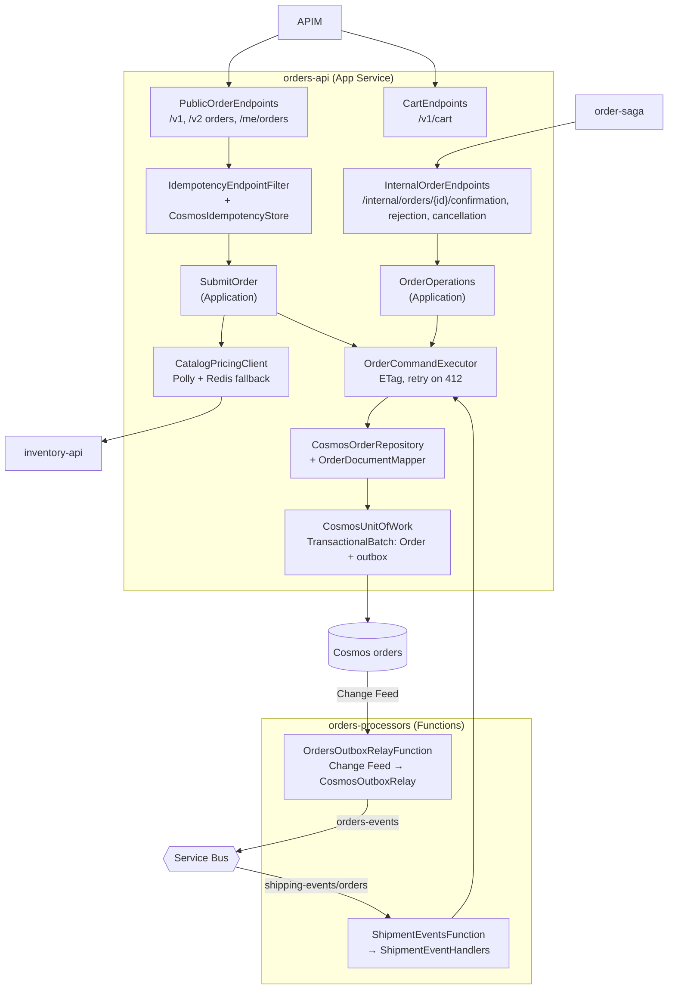
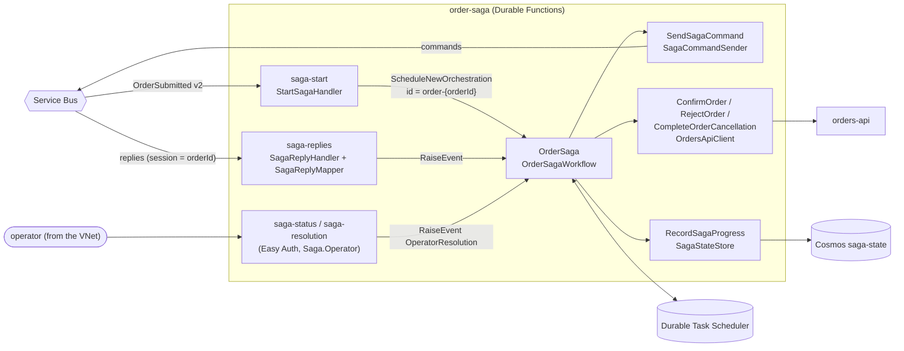
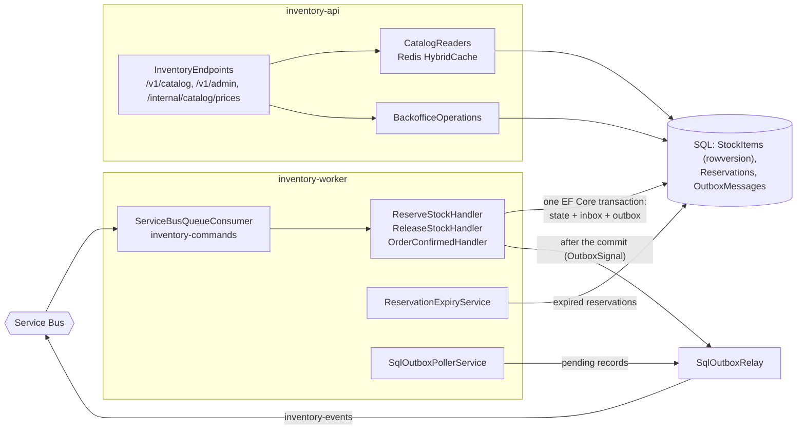
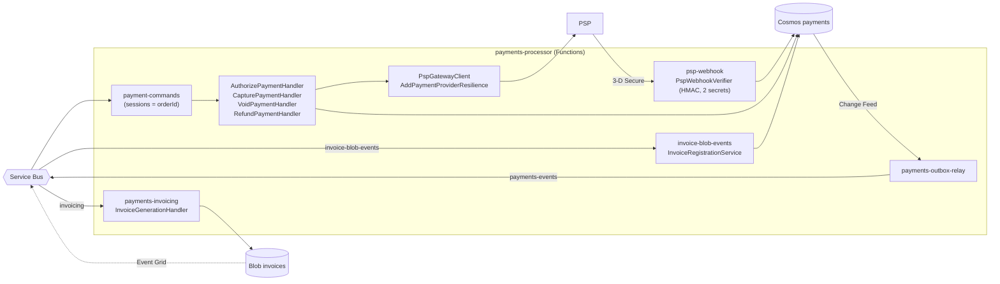

# C4, level 3: components

Components of the four contexts built in full depth: Orders, Order Saga, Inventory and Payments. Every service has the
same layers (`Domain` ← `Application` ← `Infrastructure` ← host), enforced by `tests/ShopFlow.Architecture.Tests`.
Arrows show runtime calls, not compile-time dependencies.

## Orders: `orders-api` and `orders-processors`

| Component | Project | Responsibility | Pattern |
|---|---|---|---|
| `Order`, `Cart`, `OrderStatus` | Domain | order state transition rules; domain events | aggregate, state machine |
| `SubmitOrder` | Application | validation, prices from the catalog, creating the order | port `ICatalogPricing` |
| `OrderOperations`, `OrderCommandExecutor` | Application | confirmation, rejection, cancellation; read-modify-write with an ETag | optimistic concurrency ([ADR-0007](../adr/0007-cosmos-partition-keys.md)) |
| `OrderEventPublisher` | Application | domain events → contracts `OrderSubmitted` v1/v2, `OrderConfirmed` etc. | feature flag `Orders.PublishOrderSubmittedV1` ([ADR-0012](../adr/0012-contract-versioning.md)) |
| `CosmosOrderRepository`, `CosmosUnitOfWork` | Infrastructure, BuildingBlocks | saving the aggregate and outbox records in one `TransactionalBatch` | Cosmos outbox ([ADR-0009](../adr/0009-outbox-and-inbox.md)) |
| `CatalogPricingClient` | Infrastructure | prices from `inventory-api`, cached in Redis | the `AddInternalServiceResilience` profile, a fallback when the circuit is open |
| `IdempotencyEndpointFilter` | BuildingBlocks `ShopFlow.Web` | `Idempotency-Key` on `POST /orders`: the same response for a repeated request | the `idempotency` container, 24 h TTL |
| `CosmosOutboxRelay` | BuildingBlocks `ShopFlow.Persistence.Cosmos` | outbox records from the Change Feed → Service Bus with the record's `MessageId` | broker deduplication |
| `ShipmentEventHandlers` | Application | `ShipmentDispatched` → `Shipped`, `ShipmentDelivered` → `Completed` + `OrderCompleted` | inbox in the same partition |

## Order Saga: `order-saga`

Flow, compensations, timeouts and orchestration versioning: [saga.md](saga.md).

## Inventory: `inventory-api`, `inventory-worker`

| Component | Responsibility | What to look at |
|---|---|---|
| `ReserveStockHandler` | a reservation in a warehouse with enough stock | `rowversion` on `StockItems`; a conflict is a message retry, not an error |
| `OrderConfirmedHandler` | commits the reservation before it expires | an expired reservation → DLQ with `BusinessRuleViolation` ([dlq-growth](../runbooks/dlq-growth.md#reservationnot_active)) |
| `ReservationExpiryService` | releases reservations without a confirmation | the reservation TTL is longer than the sum of the saga's timeouts |
| `SqlOutboxRelay` + `SqlOutboxPollerService` | publishing right after the commit; the poller closes gaps after a crash | the second outbox variant ([ADR-0009](../adr/0009-outbox-and-inbox.md)) |
| `CatalogReaders` | product cards and lists from HybridCache (L1 + Redis); checkout prices read SQL directly | the `inventory:` key prefix ([ADR-0016](../adr/0016-redis-scope-and-isolation.md)) |

## Payments: `payments-processor`

| Component | Responsibility | What to look at |
|---|---|---|
| Command handlers | an operation at the PSP with the key `{paymentId}-{operation}`, saving `Payment` + outbox | the session-enabled queue serializes the commands of one order |
| `PspGatewayClient` | REST calls to the PSP | 409/400/422 permanent (DLQ), 401/403 and 5xx transient ([payment-failure](../runbooks/payment-failure.md)) |
| `PspWebhookVerifier` | the webhook's HMAC signature, two secrets at once | rotation without downtime ([secret-rotation](../runbooks/secret-rotation.md)) |
| `InvoiceGenerationHandler` | the invoice number (TransactionalBatch in the `invoice-numbers:yyyy-MM` partition), the PDF to Blob | `If-None-Match: *`: a retry does not overwrite the invoice |
| `InvoiceRegistrationService` | `BlobCreated` → `Payment.AttachInvoice` + `InvoiceIssued` | Blob + Event Grid as an outbox for files |

What executes where, step by step: [docs/walkthroughs](../walkthroughs/README.md).
