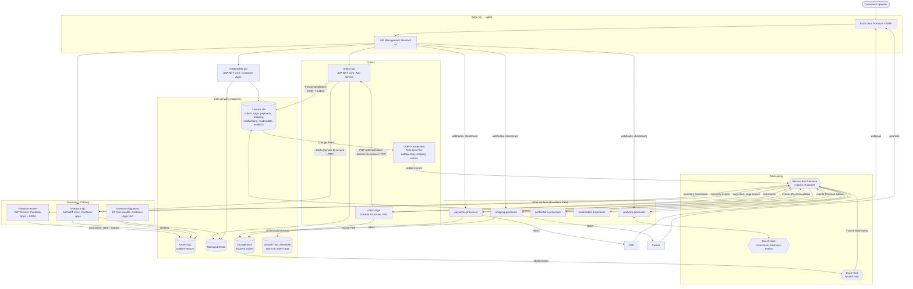

# C4, level 2: containers

A container in the C4 sense is a separately deployed process or a data store. The twelve deployable units from
[00-overview.md](00-overview.md) (section 4) plus the stores and brokers.

The saga operator API (`saga-status`, `saga-resolution`) is not exposed through APIM: operators call it from inside the
VNet ([payment-failure.md](../runbooks/payment-failure.md)).

## Containers

| Container | Technology, hosting | Responsibility | Own data | Input | Output |
|---|---|---|---|---|---|
| `orders-api` | ASP.NET Core Minimal API, App Service P*v3 with a `staging` slot | cart, placing and reading orders, the internal API for the saga | Cosmos `orders` (`orders`, `carts`, `idempotency`) | HTTP through APIM; service-to-service HTTP from the saga | Cosmos (outbox), HTTP to `inventory-api`, Redis |
| `orders-processors` | Functions Flex | outbox relay (Change Feed → `orders-events`), status change after `ShipmentDispatched` / `ShipmentDelivered` | Cosmos `orders` (`leases`) | Change Feed, the `shipping-events/orders` subscription | Service Bus |
| `order-saga` | Durable Functions, Flex, Durable Task Scheduler backend | orchestration of placing an order with compensations | DTS (history), Cosmos `saga/saga-state` (projection) | `orders-events/saga-start`, the `saga-replies` queue, operator HTTP | command queues, HTTP to `orders-api` |
| `inventory-api` | ASP.NET Core, Container Apps (internal ingress) | catalog, prices, stock receipts, prices for checkout | SQL (schemas `catalog`, `inventory`, `ref`) | HTTP through APIM and service-to-service | SQL, Redis |
| `inventory-worker` | .NET Worker, Container Apps, KEDA scaling by queue length | reservations, releases, reservation commit, reservation expiry, outbox poller | SQL (`inventory`, `messaging`) | the `inventory-commands` queue | `inventory-events` |
| `inventory-migrations` | EF Core migration bundle, Container Apps Job (manual trigger) | schema migrations started by the pipeline | — | `az containerapp job start` | SQL |
| `payments-processor` | Functions Flex + NAT Gateway | payment commands in sessions, PSP webhook, invoices | Cosmos `payments`, Blob `invoices` | `payments-commands`, webhook, `payments-events/invoicing`, `invoice-blob-events` | `payments-events`, PSP |
| `shipping-processor` | Functions Flex + NAT Gateway | shipments, labels, carrier webhook | Cosmos `shipping`, Blob `labels` | `shipping-commands`, webhook | `shipping-events`, carrier |
| `notifications-processor` | Functions Flex | e-mail and SMS after events, operations alerts | Cosmos `notifications` | `notifications-inbox` | ACS, Graph |
| `readmodels-projections` | Functions Flex | the `customer-orders` projection from the events of three contexts | Cosmos `readmodels` | `readmodels-inbox` (sessions) | Cosmos, Redis invalidation |
| `readmodels-api` | ASP.NET Core, Container Apps | "my orders" reads, the invoice link (user delegation SAS) | — (read-only access to `readmodels`) | HTTP through APIM | Cosmos, Redis, Blob |
| `analytics-processor` | Functions Flex | clickstream ingestion, business event forwarder, aggregates | Cosmos `analytics` | HTTP (clickstream), `analytics-inbox`, Event Hubs | Event Hubs, Cosmos |

## Communication between containers

| Style | Where | Why |
|---|---|---|
| Events through a Service Bus topic | every context publishes to its own topic | consumers can be added without changes at the publisher ([message-flows.md](message-flows.md)) |
| Commands through a Service Bus queue | saga → inventory, payments, shipping | one receiver; the reply comes back as an event |
| Service-to-service HTTP with an app role | saga → `orders-api`, `orders-api` → `inventory-api` | an immediate result is needed ([ADR-0010](../adr/0010-managed-identities-and-app-roles.md)) |
| Event Grid → Service Bus | Blob `invoices` → `payments-processor` | a file store as an outbox ([ADR-0005](../adr/0005-service-bus-event-hubs-event-grid.md)) |
| Event Hubs | `analytics-processor` (producer and consumer) | a high-volume, replayable stream |

Components inside Orders, the saga, Inventory and Payments: [c4-component-orders.md](c4-component-orders.md).
