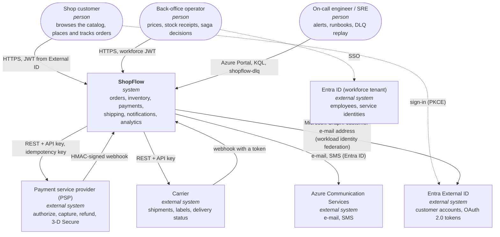

# C4, level 1: system context

Who uses ShopFlow and which external systems ShopFlow talks to. The internals are in [c4-container.md](c4-container.md).

## Actors

| Actor | Entry into the system | Authentication | Example operations |
|---|---|---|---|
| Shop customer | `https://api.shopflow.example` (Front Door) | a token from the Entra External ID tenant, validated in APIM and in the API | `POST /shop/v1/orders`, `GET /shop/v2/orders`, cancellation |
| Back-office operator | the same gateway, other APIM products | a token from the workforce tenant, app roles (`Warehouse.Operator`, `Saga.Operator`, `Support.Reader`) | price change, stock receipt, a saga decision |
| On-call engineer | Azure Portal, Log Analytics, the Durable Task Scheduler dashboard, `shopflow-dlq` from the VNet | a workforce account, roles activated just-in-time through PIM | [runbooks](../runbooks) |

## External systems

| System | Direction | Channel | When it fails |
|---|---|---|---|
| PSP | outbound and webhook | REST through the NAT Gateway (a fixed IP on the PSP's allowlist), webhook through Front Door → APIM (the PSP IP allowlist) | payment commands wait in the `payments-commands` queue; the saga waits until the step timeout ([payment-failure](../runbooks/payment-failure.md)) |
| Carrier | outbound and webhook | as for the PSP | `CreateShipment` waits; after 5 min the saga compensates |
| Azure Communication Services | outbound | SDK with a managed identity | the notification is retried; the order is not blocked |
| Entra External ID (Graph) | outbound | Microsoft Graph, a token from managed identity federation | the e-mail waits in the `notifications-inbox` queue |

## System boundary

- Front Door is the only public entry point. Everything else (APIs, functions, databases, brokers) is private; the
  exceptions are described in [network.md](network.md).
- ShopFlow has no frontend. The boundary is the API; the SPA and the mobile app are out of scope
  (see [00-overview.md](00-overview.md), section 14).
- The PSP and the carrier are fictitious. The adapters (`PspGatewayClient`, `CarrierGatewayClient`) are written as for a
  real provider: idempotency keys, resilience policies, webhook signature verification.
