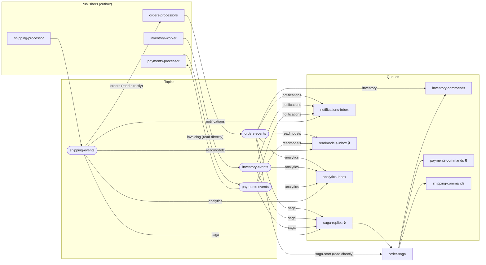
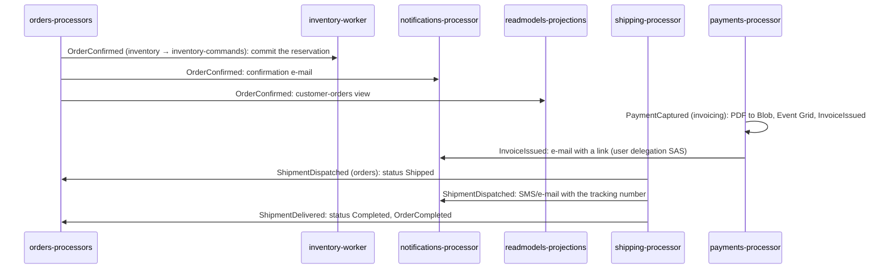

# Message flows

Who publishes, who subscribes and which way a message travels. The source of truth is
[`messaging-topology.json`](../../infra/modules/messaging/messaging-topology.json): Bicep creates the entities and roles
from it, `shopflow-dlq` computes replay targets from it, and the contract and architecture tests compare it with the code.
This document is its readable view; update both after changing the topology.

## Channel map

🔒 session-enabled queue (`SessionId = orderId`): the messages of one order are processed in sequence, different orders in parallel.

## Commands (point-to-point queues)

Only the saga sends commands. The reply comes back as an event on the participant's topic, and the `saga` subscription
forwards it to `saga-replies`.

| Command | Queue | Receiver | Success reply | Failure reply |
|---|---|---|---|---|
| `ReserveStock` | `inventory-commands` | `inventory-worker` | `StockReserved` | `StockReservationFailed` |
| `ReleaseStock` | `inventory-commands` | `inventory-worker` | `StockReleased` | — (state-tolerant) |
| `AuthorizePayment` | `payments-commands` 🔒 | `payments-processor` | `PaymentAuthorized` | `PaymentDeclined` |
| `CapturePayment` | `payments-commands` 🔒 | `payments-processor` | `PaymentCaptured` | `PaymentCaptureFailed` |
| `VoidPayment` | `payments-commands` 🔒 | `payments-processor` | `PaymentVoided` | — |
| `RefundPayment` | `payments-commands` 🔒 | `payments-processor` | `PaymentRefunded` | — |
| `CreateShipment` (v1 courier, v2 pickup point) | `shipping-commands` | `shipping-processor` | `ShipmentCreated` | `ShipmentCreationFailed` |
| `CancelShipment` | `shipping-commands` | `shipping-processor` | `ShipmentCancelled` | — |

`inventory-commands` also receives the `OrderConfirmed` event (the `orders-events/inventory` subscription): committing a
reservation is a reaction to a fact, not a saga command, so there is no reply.

## Events (publish/subscribe topics)

| Event | Topic | Subscriptions (→ target) |
|---|---|---|
| `OrderSubmitted` (v1 and v2) | `orders-events` | `saga-start` (v2 only, read by the saga), `readmodels`, `analytics` |
| `OrderCancellationRequested` | `orders-events` | `saga` → `saga-replies`, `readmodels`, `analytics` |
| `OrderConfirmed` | `orders-events` | `inventory` → `inventory-commands`, `notifications`, `readmodels`, `analytics` |
| `OrderRejected`, `OrderCancelled` | `orders-events` | `notifications`, `readmodels`, `analytics` |
| `OrderCompleted` | `orders-events` | `readmodels`, `analytics` |
| `StockReserved`, `StockReservationFailed`, `StockReleased` | `inventory-events` | `saga`, `analytics` |
| `StockLevelLow` | `inventory-events` | `notifications`, `analytics` |
| `ProductPriceChanged` | `inventory-events` | `analytics` |
| `PaymentAuthorized`, `PaymentDeclined`, `PaymentCaptureFailed`, `PaymentVoided` | `payments-events` | `saga`, `readmodels`, `analytics` |
| `PaymentCaptured` | `payments-events` | `saga`, `invoicing` (read by Payments), `readmodels`, `analytics` |
| `PaymentRefunded` | `payments-events` | `saga`, `notifications`, `readmodels`, `analytics` |
| `InvoiceIssued` | `payments-events` | `notifications`, `readmodels`, `analytics` |
| `ShipmentCreated`, `ShipmentCreationFailed`, `ShipmentCancelled` | `shipping-events` | `saga`, `readmodels`, `analytics` |
| `ShipmentDispatched`, `ShipmentDelivered` | `shipping-events` | `orders` (read by Orders), `notifications`, `readmodels`, `analytics` |

Subscription filters work on `Subject` (the message type): a correlation rule for one type, a SQL rule
`sys.Label IN (...)` for several. The `readmodels` and `analytics` subscriptions have no filter.

## End-to-end flows

### Placing an order (orchestration)

`POST /orders` → Cosmos (`Order` + outbox) → Change Feed → `OrderSubmitted` → saga → commands and replies →
`PUT /internal/orders/{id}/confirmation` → `OrderConfirmed`. Steps, timeouts and compensations: [saga.md](saga.md).

### Aftermath of the confirmation (choreography)

### Cancellation by the customer

1. `POST /v2/orders/{id}/cancellation` on `orders-api` (with `If-Match`) changes the state to `CancellationRequested`
   and saves the `OrderCancellationRequested` outbox record. Walkthrough:
   [03-customer-cancellation.md](../walkthroughs/03-customer-cancellation.md).
2. The `orders-events/saga` subscription forwards the event to `saga-replies`; the saga checks it between steps.
3. The saga compensates the completed steps and calls `PUT /internal/orders/{id}/cancellation`; Orders publishes `OrderCancelled`.
4. If the request reaches Orders before the saga confirms the order, the confirmation returns 409
   `cancellation_pending` and the saga moves to compensation as well.

### Invoice (Blob Storage as an outbox for files)

`PaymentCaptured` → `payments-invoicing` writes the PDF to `invoices/` → Event Grid (`BlobCreated`, filter
`/containers/invoices/` + `.pdf`) → the `invoice-blob-events` queue → invoice registration and `InvoiceIssued`.
A correction invoice uploaded manually by back-office takes the same path.

### Analytics (Event Hubs)

| Source | Hub | Partition key | Consumer |
|---|---|---|---|
| `POST /collect` in APIM → the `clickstream` HTTP function (APIM with the `Analytics.Ingest` role) | `clickstream` | `sessionId` | `cg-funnel-aggregator`: the conversion funnel (approximate) |
| `analytics-inbox` (all business events) | `business-events` | `orderId` | `cg-business-metrics`: revenue per minute (exact) |

## Message envelope

Every Service Bus message carries `MessageId` (the outbox record identifier), `Subject` (the type), `SessionId`
(`orderId`), `CorrelationId` (constant for the whole order), the `ContractVersion`, `CausationId` and `Source`
properties, and `traceparent`. The full table: [00-overview.md](00-overview.md), section 6.5.

## When a message does not get through

| Situation | What the consumer does | Where it ends up |
|---|---|---|
| Transient error (timeout, 429, 503, ETag conflict) | throws; the message goes back to the queue | DLQ after `maxDeliveryCount` (5 for commands, 10 for inbox queues), reason `MaxDeliveryCountExceeded` |
| Permanent error (bad envelope, unknown type, validation, business rule) | `DeadLetterAsync` immediately | DLQ with reason `MalformedEnvelope`, `DeserializationFailed`, `UnhandledMessageType`, `ValidationFailed`, `BusinessRuleViolation` |
| Duplicate | the inbox recognises the `MessageId` | completed without effect |
| Message too early (e.g. `ShipmentDelivered` before `ShipmentDispatched`) | `OutOfOrderMessageException`, retry | DLQ after the attempts are exhausted |

Handling the DLQ: [runbooks/dlq-growth.md](../runbooks/dlq-growth.md). Adding a new message or subscription: the
`/add-message-contract` and `/add-message-consumer` skills.
