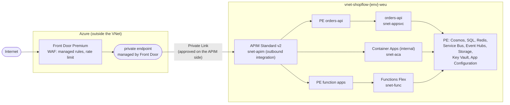

# Network

One VNet per environment, the same topology in dev, test and prod (only the address space differs).
Code: [vnet.bicep](../../infra/modules/network/vnet.bicep), [private-dns-zones.bicep](../../infra/modules/network/private-dns-zones.bicep),
[front-door.bicep](../../infra/modules/edge/front-door.bicep). Decisions and exceptions: [ADR-0011](../adr/0011-network-topology.md).

## Request path

1. The client connects to Front Door (`api.shopflow.example`). The WAF rejects known attacks and excess requests.
2. Front Door connects to the APIM gateway through **its own private endpoint** (Private Link). Once the connection is
   approved, APIM has `publicNetworkAccess: Disabled` (the `APIM_PRIVATE_ONLY` variable in the GitHub environment).
3. APIM reaches into the VNet through integration with the `snet-apim` subnet and calls backends at private addresses.
4. Backends connect to data and brokers through private endpoints in `snet-pe`.

An invoice file takes the second Front Door route (`files.shopflow.example`) to the `docs` account through Private Link.
`readmodels-api` and `shipping-processor` issue links with a user delegation SAS on that host
(`BlobLinks__PublicBaseUrl`), because the `*.blob.core.windows.net` address is not reachable from the internet.

## Subnets

Example for dev (`10.10.0.0/22`). The split is computed by `cidrSubnet()`, so test (`10.20.0.0/22`) and prod
(`10.30.0.0/22`) have the same layout.

| Subnet | Addresses (dev) | Delegation | NAT Gateway | Content |
|---|---|---|---|---|
| `snet-apim` | `10.10.0.0/27` | `Microsoft.Web/serverFarms` | no | APIM Standard v2 outbound integration |
| `snet-appsvc` | `10.10.0.32/27` | `Microsoft.Web/serverFarms` | yes | `orders-api` outbound integration |
| `snet-runners` | `10.10.0.64/26` | `GitHub.Network/networkSettings` | yes | GitHub Actions runners (code deployments through SCM) |
| `snet-func` | `10.10.1.0/24` | `Microsoft.App/environments` | yes | outbound integration of the seven function apps |
| `snet-aca` | `10.10.2.0/24` | `Microsoft.App/environments` | yes | the Container Apps environment (internal ingress) |
| `snet-pe` | `10.10.3.0/24` | — | no | private endpoints; the NSG denies inbound internet traffic |

Free: `10.10.0.128/25` for further small subnets (e.g. Azure Bastion needs a `/26`).

## Private endpoints and DNS

Every private endpoint has a record in a private DNS zone linked to the VNet. The application uses the usual name
(`cosmos-shopflow-prod-weu.documents.azure.com`), public DNS returns a CNAME to `*.privatelink.*`, and the private zone
resolves it to an address in `snet-pe`. No configuration in code is needed.

| Service | `groupId` | Zone |
|---|---|---|
| Cosmos DB | `Sql` | `privatelink.documents.azure.com` |
| Azure SQL | `sqlServer` | `privatelink.database.windows.net` |
| Managed Redis | `redisEnterprise` | `privatelink.redis.azure.net` |
| Service Bus, Event Hubs | `namespace` | `privatelink.servicebus.windows.net` |
| Storage `docs`, `func`, `lake` | `blob`, `queue`, `table`, `dfs` | `privatelink.{blob,queue,table,dfs}.core.windows.net` |
| Key Vault | `vault` | `privatelink.vaultcore.azure.net` |
| App Configuration | `configurationStores` | `privatelink.azconfig.io` |
| `orders-api` (+ the `staging` slot) | `sites`, `sites-staging` | `privatelink.azurewebsites.net` |
| 7 function apps | `sites` | `privatelink.azurewebsites.net` |
| Container Apps | — (internal environment) | a `{defaultDomain}` zone with a `*` record pointing at the environment's static IP ([container-apps-dns.bicep](../../infra/modules/network/container-apps-dns.bicep)) |

A `sites` private endpoint also covers the SCM endpoint (`*.scm.azurewebsites.net`) used to deploy code. That is why
every function app has a private endpoint, including those without HTTP triggers, and the pipeline deploys from a runner
in the VNet ([.github/README.md](../../.github/README.md)).

## Outbound traffic

| Source | Destination | How |
|---|---|---|
| `payments-processor`, `shipping-processor` | PSP, carrier | NAT Gateway: one fixed public IP for the partners' allowlists |
| `order-saga` | Durable Task Scheduler | NAT Gateway; the scheduler has an `ipAllowlist` with the NAT address and requires an identity with a role on the task hub |
| `notifications-processor` | Azure Communication Services, Microsoft Graph | NAT Gateway, Entra ID authentication (services without private endpoints) |
| all | Azure Monitor (telemetry ingestion) | public endpoint with Entra ID authentication |
| Container Apps | Container Registry (image pull) | the registry's public endpoint, an identity with the AcrPull role |

## Deliberate exceptions to "everything private"

| Resource | Public access | Why | What protects it |
|---|---|---|---|
| Front Door | yes (the only entry) | the system is an online shop | WAF, TLS, rate limit, only APIM and `docs` as origins |
| Service Bus | endpoint with a default deny | Event Grid delivers `BlobCreated` from outside the VNet | the "trusted services" exception, managed identity, no IP rules |
| Storage `docs`, `lake` | as above | Event Grid dead-lettering, Event Hubs Capture | as above, shared keys disabled |
| Container Registry | yes | shared by environments, pulled by Container Apps | Entra ID only, no admin account or anonymous pull |
| Durable Task Scheduler | IP allowlist | private endpoint skipped: one service, one caller, fewer DNS zones | NAT Gateway IP + a role on the task hub |
| Azure Monitor ingestion | yes | AMPLS for a single workspace is cost and complexity without gain | Entra ID (`DisableLocalAuth`) |

## Traffic control inside the VNet

- An NSG on every subnet; `snet-pe` has a `deny-internet-inbound` rule and private endpoint network policies enabled.
- VNet flow logs are not enabled: a deliberate simplification, discussed in [cost.md](../cost.md).
- No Azure Firewall: outbound traffic is restricted by identity on the target services, not by an FQDN allowlist. In an
  organization with an outbound inspection requirement (e.g. PCI DSS) a hub with a firewall and a default route through
  it are added; the NAT Gateway then moves to the hub.
