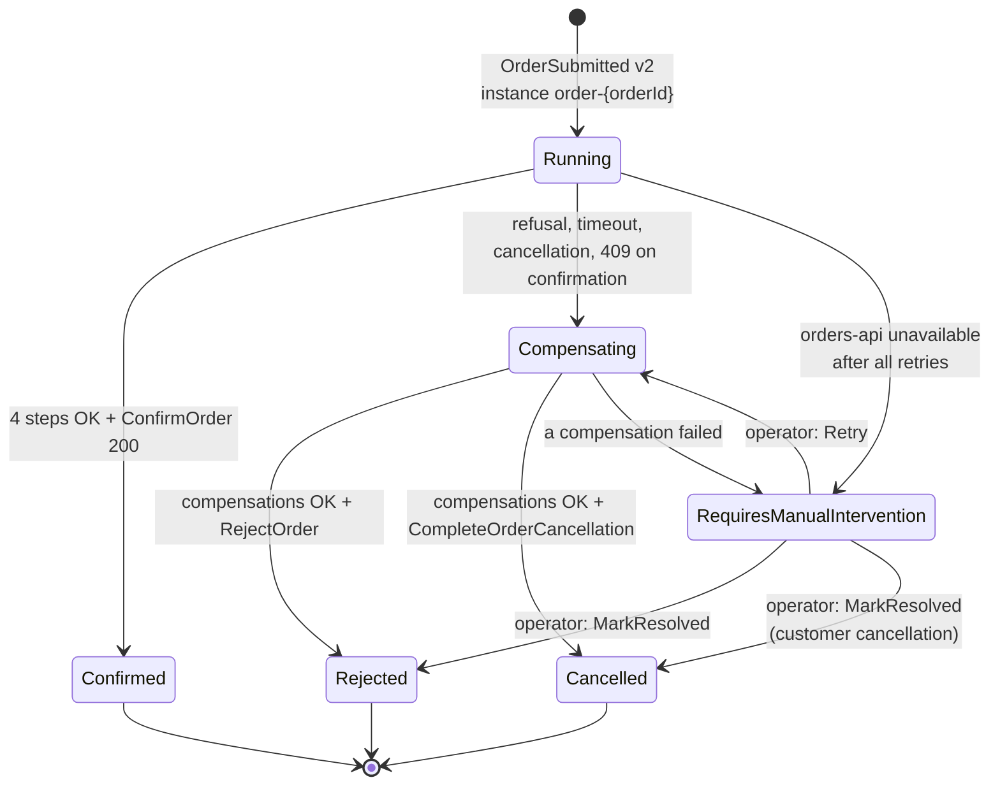

# Order saga

Orchestration of placing an order in Durable Functions: [`OrderSagaWorkflow.cs`](../../src/Services/OrderSaga/ShopFlow.OrderSaga/Workflow/OrderSagaWorkflow.cs).
Why orchestration only here and choreography afterwards: [ADR-0008](../adr/0008-saga-orchestration-vs-choreography.md).

## State machine

The saga state (`SagaStatus`) is visible in the instance's custom status, in the `saga/saga-state` projection and in
the `GET /api/sagas/{orderId}` response.

## Steps

| # | Command | Waits for event | Timeout (`Saga:*Timeout`) | Compensation | When there is no reply |
|---|---|---|---|---|---|
| 1 | `ReserveStock` | `ReserveStock` | 2 min | `ReleaseStock` | rejection `internal_error` |
| 2 | `AuthorizePayment` (the saga assigns the `PaymentId`) | `AuthorizePayment` | 15 min (3-D Secure) | `VoidPayment` | rejection `payment_timeout` |
| 3 | `CreateShipment` | `CreateShipment` | 5 min | `CancelShipment` | rejection `shipment_unavailable` |
| 4 | `CapturePayment` | `CapturePayment` | 5 min | `VoidPayment` replaced with `RefundPayment` | rejection `internal_error` |
| 5 | `ConfirmOrder` (HTTP `PUT /internal/orders/{id}/confirmation`, `If-Match`) | the activity result | durable retries: 8 attempts, 5 s → 5 min | — | escalation to an operator |

Compensations have their own timeout `CompensationTimeout` (10 min). The sum of the timeouts up to the confirmation
(2 + 15 + 5 + 5 = 27 min) must be shorter than the reservation lifetime in Inventory (`Reservation:TimeToLive`, 60 min).

The name of an external event is the name of the command it answers. `SagaReplyMapper` turns `PaymentCaptured` and
`PaymentCaptureFailed` into the `CapturePayment` event. A late duplicate of `PaymentAuthorized` is therefore never taken
as the reply to the capture (see `SagaEvents` in [`SagaNames.cs`](../../src/Services/OrderSaga/ShopFlow.OrderSaga/Model/SagaNames.cs)).

## Compensation rules

1. **A compensation goes on the list before the command is sent**, and is removed only after a clear refusal.
   A timeout ("I do not know whether the step ran") is handled like a success.
2. This works because **compensations are state-tolerant**: releasing a non-existent reservation, cancelling a
   non-existent shipment and refunding an uncaptured payment succeed without effect.
3. **Reverse order, one by one, not in parallel.** Easier to follow in the history, and a few seconds make no business
   difference.
4. **From the moment `CapturePayment` is sent the payment compensation is a refund.** After a timeout we do not know
   whether the money was captured; Payments performs a refund of an uncaptured payment as releasing the hold. After a
   clear capture refusal the saga goes back to `VoidPayment`.
5. A failed compensation is retried as a whole round only after an operator decision (`Retry`), with a new attempt
   number in the key (`ReleaseStock/2`). Otherwise the next attempt's `MessageId` would equal the first one's and the
   broker would silently drop it as a duplicate.

## Cancellation in flight

A `WaitForExternalEvent("CancellationRequested")` task is created at the start and checked between steps. The step in
progress finishes normally (we do not cut off waiting for a payment in the middle of 3-D Secure), then the saga
compensates everything and calls `CompleteOrderCancellation`. Orders settles the race with the confirmation: if the
cancellation request reached the order first, `ConfirmOrder` gets 409 `cancellation_pending`.

## Operator intervention

The saga moves to `RequiresManualIntervention` when:

- a compensation did not get a success reply within `CompensationTimeout`,
- a call to `orders-api` (`ConfirmOrder`, `RejectOrder`, `CompleteOrderCancellation`) failed after all retries.

The instance logs a `Critical` entry "requires manual intervention" (the `saga-manual-intervention` alert) and waits
without a time limit for the `OperatorResolution` event. The operator answers through
`POST /api/sagas/{orderId}/resolution` with the `Saga.Operator` role:

| `action` | Effect |
|---|---|
| `Retry` | retries the failed compensations or the `orders-api` call |
| `MarkResolved` | the operator fixed it manually (e.g. a refund in the PSP panel); the saga ends as `Rejected` or `Cancelled` |

Step-by-step procedure: [runbooks/payment-failure.md](../runbooks/payment-failure.md#b-saga-in-the-requiresmanualintervention-state).

## Guarantees and idempotency

| Threat | Defence |
|---|---|
| `OrderSubmitted` delivered twice | the instance identifier `order-{orderId}`; starting an existing instance is ignored |
| A participant reply delivered twice | the external event goes into the instance's buffer, and nobody receives it again |
| A command sent twice (activity retry) | `MessageId` derived from `order-{orderId}/{step}` (`DeterministicGuid`) + 10-minute queue deduplication + the participant's inbox |
| A restart or deployment mid-saga | the state is in the Durable Task Scheduler history; timers and retries are durable |
| Two replies of one order at the same time | the session-enabled `saga-replies` queue, session = `orderId` |

## Two places of state

| Place | What | What for |
|---|---|---|
| Durable Task Scheduler (task hub `order-saga`) | the orchestration event history (event sourcing) | control: replay rebuilds the state after every `await` |
| Cosmos `saga/saga-state` (TTL 90 days) | a projection: status, current step, list of steps with outcomes | customer support, diagnostics, queries; a write failure does not stop the saga |

## Orchestration versioning

The orchestrator code is replayed from the start at every step, so changing the order, number or names of durable calls
breaks instances that are already running. In [host.json](../../src/Services/OrderSaga/ShopFlow.OrderSaga.Functions/host.json):
`defaultVersion: "1.0"`, `versionMatchStrategy: CurrentOrOlder`, `versionFailureStrategy: Reject`.
A breaking change is a new `defaultVersion` and a branch in the code on `context.Version`. Details in the
[order-saga README](../../src/Services/OrderSaga/ShopFlow.OrderSaga.Functions/README.md#deployments-and-running-instances).
Walkthroughs: [placing an order](../walkthroughs/01-place-order.md), [payment declined](../walkthroughs/02-payment-declined-compensation.md).
