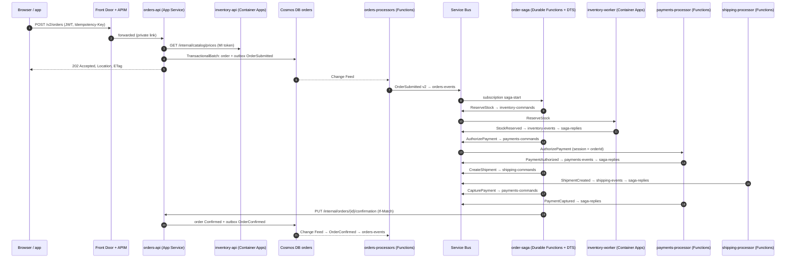

# 01. A customer places an order (happy path)

The customer has items in the cart and clicks "Buy". The order is accepted immediately (202), and the fulfilment saga
reserves stock, authorizes the payment, books a courier and captures the money. Only then is the order confirmed.

Patterns: [idempotent receiver](../architecture/patterns.md#idempotent-receiver),
[transactional outbox](../architecture/patterns.md#transactional-outbox),
[saga orchestration](../architecture/patterns.md#saga-orchestration),
[competing consumers](../architecture/patterns.md#competing-consumers),
[message sessions](../architecture/patterns.md#ordered-delivery-with-sessions),
[correlation identifier](../architecture/patterns.md#correlation-identifier).

## Sequence



## Steps

### Accepting the order (synchronous, ~100 ms)

| # | Where | What happens | Code | Data / message |
|---|---|---|---|---|
| 1 | Front Door Premium + WAF → APIM Standard v2 | TLS and WAF at the edge; Front Door reaches APIM through Private Link. APIM validates the JWT (External ID tenant), applies rate limits and calls orders-api at a private address through its VNet integration ([network.md](../architecture/network.md)). | [infra/apim/policies](../../infra/apim/policies) | — |
| 2 | `orders-api` (App Service) | The `/v2/orders` endpoint requires `Idempotency-Key`. The filter stores the key in Cosmos before the handler runs; a repeat with the same key returns the stored response. | [PublicOrderEndpoints.cs](../../src/Services/Orders/ShopFlow.Orders.Api/Endpoints/PublicOrderEndpoints.cs) `SubmitV2`, [IdempotencyEndpointFilter.cs](../../src/BuildingBlocks/ShopFlow.Web/Idempotency/IdempotencyEndpointFilter.cs) | Cosmos `orders/idempotency` (partition `/scopeKey`, TTL 24 h) |
| 3 | `orders-api` | The command is validated (FluentValidation), the cart is read (point read). | [SubmitOrder.cs](../../src/Services/Orders/ShopFlow.Orders.Application/Orders/SubmitOrder.cs) `SubmitOrderHandler` | Cosmos `orders/carts` (partition `/customerId`) |
| 4 | `orders-api` → `inventory-api` (Container Apps, internal) | Prices come from the catalog, never from the client. Service-to-service HTTP inside the VNet with an Entra ID token (role `Catalog.Prices.Read`), resilience pipeline. Every successful price is also stored in Redis by orders-api; it stands in for the catalog for up to 15 minutes only when inventory-api does not answer. | [CatalogPricingClient.cs](../../src/Services/Orders/ShopFlow.Orders.Infrastructure/Catalog/CatalogPricingClient.cs); server side [InventoryEndpoints.cs](../../src/Services/Inventory/ShopFlow.Inventory.Api/Endpoints/InventoryEndpoints.cs) `/internal/catalog/prices`, [CatalogReaders.cs](../../src/Services/Inventory/ShopFlow.Inventory.Infrastructure/Catalog/CatalogReaders.cs) | Azure SQL directly: checkout prices bypass the HybridCache used for product pages |
| 5 | `orders-api` | `Order.Submit` creates the aggregate with a UUID v7 id. `OrderEventPublisher` translates the domain event into `OrderSubmitted` v2 (and v1 while the `Orders.PublishOrderSubmittedV1` flag is on) and puts it into the outbox. | [Order.cs](../../src/Services/Orders/ShopFlow.Orders.Domain/Orders/Order.cs), [OrderEventPublisher.cs](../../src/Services/Orders/ShopFlow.Orders.Application/Orders/OrderEventPublisher.cs) | in-memory outbox buffer |
| 6 | `orders-api` → Cosmos DB | The order document and the outbox records are written in **one `TransactionalBatch`** in the order's partition: both or neither. | [CosmosOrderRepository.cs](../../src/Services/Orders/ShopFlow.Orders.Infrastructure/Cosmos/CosmosOrderRepository.cs), [CosmosUnitOfWork.cs](../../src/BuildingBlocks/ShopFlow.Persistence.Cosmos/CosmosUnitOfWork.cs) | Cosmos `orders/orders` (partition `/orderId`) |
| 7 | `orders-api` | The cart is emptied on a best-effort basis (another partition, no transaction). The response is **202 Accepted** with `Location` and `ETag`: the saga decides the outcome. | `SubmitOrderHandler.ClearCartAsync` | — |

### Publishing the event (asynchronous, ~1–3 s)

| # | Where | What happens | Code | Data / message |
|---|---|---|---|---|
| 8 | `orders-processors` (Functions Flex) | The Change Feed trigger picks up the new document; the relay publishes its outbox records. `MessageId` = outbox record id, `SessionId` = `orderId`, `CorrelationId` stays the same for the whole order. Failure → the batch is retried (exponential backoff), the lease does not move. | [OrdersOutboxRelayFunction.cs](../../src/Services/Orders/ShopFlow.Orders.Processors/Functions/OrdersOutboxRelayFunction.cs), [CosmosOutboxRelay.cs](../../src/BuildingBlocks/ShopFlow.Persistence.Cosmos/CosmosOutboxRelay.cs) | `OrderSubmitted` v2 → topic `orders-events` (lease container `orders/leases`) |
| 9 | Service Bus | The `saga-start` subscription (correlation filter: `OrderSubmitted`, `ContractVersion = 2`) holds it for the saga. `readmodels` and `analytics` get a copy too (scenarios [07](07-my-orders-read-model.md), [08](08-clickstream-analytics.md)). | [messaging-topology.json](../../infra/modules/messaging/messaging-topology.json) | subscription `orders-events/saga-start` |

### The saga (asynchronous, seconds to minutes)

| # | Where | What happens | Code | Data / message |
|---|---|---|---|---|
| 10 | `order-saga` (Functions Flex + DTS) | `saga-start` deserializes the message and schedules the orchestration with instance id `order-{orderId}`. A duplicate start is ignored because the instance already exists. | [SagaMessagingFunctions.cs](../../src/Services/OrderSaga/ShopFlow.OrderSaga.Functions/Functions/SagaMessagingFunctions.cs), [SagaMessageHandlers.cs](../../src/Services/OrderSaga/ShopFlow.OrderSaga/Messaging/SagaMessageHandlers.cs) `StartSagaHandler` | DTS task hub `order-saga` |
| 11 | `order-saga` | The orchestrator records progress (projection) and runs step 1. **Before** sending a command it pushes the compensation (`ReleaseStock`) onto the list. | [OrderSagaWorkflow.cs](../../src/Services/OrderSaga/ShopFlow.OrderSaga/Workflow/OrderSagaWorkflow.cs), [SagaStateStore.cs](../../src/Services/OrderSaga/ShopFlow.OrderSaga/Activities/SagaStateStore.cs) | Cosmos `saga/saga-state` |
| 12 | `order-saga` (activity `SendSagaCommand`) | The activity sends `ReserveStock` with a deterministic `MessageId` (`order-{id}/ReserveStock`), so an activity retry is dropped by duplicate detection. The orchestrator then waits for the external event `ReserveStock` with a 2-minute timer. | [SagaCommandSender.cs](../../src/Services/OrderSaga/ShopFlow.OrderSaga/Activities/SagaCommandSender.cs), [OrderSagaFunctions.cs](../../src/Services/OrderSaga/ShopFlow.OrderSaga.Functions/Functions/OrderSagaFunctions.cs) | `ReserveStock` → queue `inventory-commands` |
| 13 | `inventory-worker` (Container Apps + KEDA) | A long-running `ServiceBusProcessor` (scaled by queue length) dispatches the command. The handler allocates stock across warehouses; reservation, stock levels, the reply in the outbox and the inbox entry are saved in **one SQL transaction**. | [Worker/Program.cs](../../src/Services/Inventory/ShopFlow.Inventory.Worker/Program.cs), [ServiceBusQueueConsumer.cs](../../src/BuildingBlocks/ShopFlow.Messaging.ServiceBus/ServiceBusQueueConsumer.cs), [ReservationHandlers.cs](../../src/Services/Inventory/ShopFlow.Inventory.Application/Reservations/ReservationHandlers.cs) `ReserveStockHandler`, [Reservation.cs](../../src/Services/Inventory/ShopFlow.Inventory.Domain/Stock/Reservation.cs) | Azure SQL `inventory` (`Reservations`, `StockItems`, `messaging.OutboxMessages`, `messaging.InboxMessages`) |
| 14 | `inventory-worker` (background service) | The SQL outbox poller publishes `StockReserved`. The `saga` subscription forwards it to the session-enabled `saga-replies` queue. | [SqlOutboxPollerService.cs](../../src/BuildingBlocks/ShopFlow.Persistence.SqlServer/Messaging/SqlOutboxPollerService.cs), [SqlOutboxRelay.cs](../../src/BuildingBlocks/ShopFlow.Persistence.SqlServer/Messaging/SqlOutboxRelay.cs) | `StockReserved` → `inventory-events` → `saga-replies` |
| 15 | `order-saga` (`saga-replies` trigger, session = `orderId`) | The reply is mapped to the name of the command it answers and raised as an external event on `order-{orderId}`. The orchestrator wakes up (replay from the DTS history). | [SagaReplyMapper.cs](../../src/Services/OrderSaga/ShopFlow.OrderSaga/Model/SagaReplyMapper.cs), `SagaReplyHandler` in [SagaMessageHandlers.cs](../../src/Services/OrderSaga/ShopFlow.OrderSaga/Messaging/SagaMessageHandlers.cs) | external event `ReserveStock` |
| 16 | `payments-processor` (Functions Flex, VNet + NAT Gateway) | Step 2: `AuthorizePayment` (with a `PaymentId` chosen by the saga). The handler calls the PSP with the idempotency key `{paymentId:N}-authorize`; the fixed NAT IP is on the PSP allowlist. Payment + outbox `PaymentAuthorized` + inbox go in one Cosmos batch; the Change Feed relay publishes. | [PaymentMessagingFunctions.cs](../../src/Services/Payments/ShopFlow.Payments.Functions/Functions/PaymentMessagingFunctions.cs), [PaymentCommandHandlers.cs](../../src/Services/Payments/ShopFlow.Payments.Application/Commands/PaymentCommandHandlers.cs) `AuthorizePaymentHandler`, [PspGatewayClient.cs](../../src/Services/Payments/ShopFlow.Payments.Infrastructure/Psp/PspGatewayClient.cs) | queue `payments-commands` (sessions) → Cosmos `payments/payments` → `payments-events` |
| 17 | `shipping-processor` (Functions Flex) | Step 3: `CreateShipment` v1 (courier) or v2 (pickup point) is handled by one handler; it books the carrier (API key from Key Vault via App Configuration) and replies `ShipmentCreated`. | [ShippingFunctions.cs](../../src/Services/Shipping/ShopFlow.Shipping.Functions/ShippingFunctions.cs), [ShipmentHandlers.cs](../../src/Services/Shipping/ShopFlow.Shipping.Application/ShipmentHandlers.cs) `CreateShipmentHandler` | queue `shipping-commands` → Cosmos `shipping/shipments` → `shipping-events` |
| 18 | `payments-processor` | Step 4: `CapturePayment`. From this moment the saga's payment compensation is a refund instead of a void. | `CapturePaymentHandler` | `PaymentCaptured` → `saga-replies` |
| 19 | `order-saga` (activity `ConfirmOrder`) → `orders-api` | Synchronous HTTP: `GET` for the ETag, then `PUT /internal/orders/{id}/confirmation` with `If-Match` and an Entra ID token with the `Orders.Internal.Write` app role. Durable retry policy: 8 attempts, 5 s → 5 min. | [OrdersApiClient.cs](../../src/Services/OrderSaga/ShopFlow.OrderSaga/Activities/OrdersApiClient.cs), [InternalOrderEndpoints.cs](../../src/Services/Orders/ShopFlow.Orders.Api/Endpoints/InternalOrderEndpoints.cs), [OrderOperations.cs](../../src/Services/Orders/ShopFlow.Orders.Application/Orders/OrderOperations.cs) `SagaOrderOperations` | Cosmos `orders/orders` + outbox `OrderConfirmed` |
| 20 | `orders-processors` | The relay publishes `OrderConfirmed`. Subscribers: `inventory` (forwarded to `inventory-commands`: the reservation is committed), `notifications` (confirmation e-mail), `readmodels`, `analytics`. The saga records `Confirmed` and ends. | [OrdersOutboxRelayFunction.cs](../../src/Services/Orders/ShopFlow.Orders.Processors/Functions/OrdersOutboxRelayFunction.cs), `OrderConfirmedHandler` in [ReservationHandlers.cs](../../src/Services/Inventory/ShopFlow.Inventory.Application/Reservations/ReservationHandlers.cs) | `OrderConfirmed` → `orders-events` |

## Identities on the way

| Hop | Identity | Permission (scope) |
|---|---|---|
| orders-api → Cosmos | `id-…-orders-api` | Built-in Data Contributor on database `orders` |
| orders-api → inventory-api | same | app role `Catalog.Prices.Read` on the inventory API registration |
| orders-processors → Service Bus | `id-…-orders-processors` | Data Sender on topic `orders-events` only |
| order-saga → queues | `id-…-order-saga` | Data Sender on the three command queues, Data Receiver on `saga-replies` and `orders-events/saga-start`, Durable Task Data Contributor on the task hub |
| order-saga → orders-api | same | app role `Orders.Internal.Write` |
| inventory-worker → SQL | `id-…-inventory-worker` | database role `app_inventory_worker` |

Identity names follow `id-shopflow-{unit}-{env}-weu`.

Full matrix: [identity-rbac.md](../architecture/identity-rbac.md).

## What can go wrong here

| Failure | Behavior | Walkthrough |
|---|---|---|
| The client retries `POST` after a timeout | same `Idempotency-Key` → the stored 202 is returned, no second order | — |
| Catalog unavailable and no cached price | 503 with `Retry-After: 30`; nothing is written | — |
| Relay crashes after publishing, before the lease checkpoint | republish with the same `MessageId` → dropped by duplicate detection (10 min) or by the consumer's inbox | [05](05-poison-message-and-replay.md) |
| Out of stock, card declined, no carrier, timeouts | compensation in reverse order, `OrderRejected` | [02](02-payment-declined-compensation.md) |
| Customer cancels mid-saga | compensation, `OrderCancelled` | [03](03-customer-cancellation.md) |
| orders-api down during confirmation | durable retries, then `RequiresManualIntervention` and an alert | [payment-failure runbook](../runbooks/payment-failure.md) |

## Try it locally

```powershell
dotnet test --project src/Services/Orders/tests/ShopFlow.Orders.UnitTests --filter-class "*SubmitOrderHandlerTests"
```

```powershell
dotnet test --project src/Services/OrderSaga/tests/ShopFlow.OrderSaga.UnitTests --filter-class "*OrderSagaWorkflowTests"
```

Also worth reading: [ReservationHandlerTests.cs](../../src/Services/Inventory/tests/ShopFlow.Inventory.UnitTests/Application/ReservationHandlerTests.cs),
[PaymentHandlerTests.cs](../../src/Services/Payments/tests/ShopFlow.Payments.UnitTests/PaymentHandlerTests.cs),
[IdempotencyEndpointFilterTests.cs](../../src/BuildingBlocks/tests/ShopFlow.BuildingBlocks.Tests/Web/IdempotencyEndpointFilterTests.cs),
[CosmosUnitOfWorkTests.cs](../../src/BuildingBlocks/tests/ShopFlow.BuildingBlocks.Tests/Cosmos/CosmosUnitOfWorkTests.cs).
