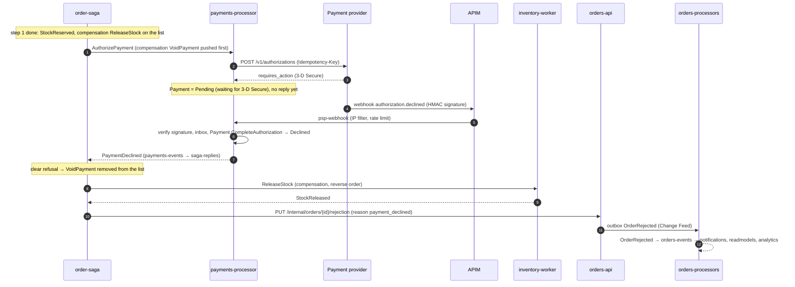

# 02. The card is declined: compensation (plus 3-D Secure and timeouts)

Stock is already reserved when the payment provider (PSP) declines the card. The saga must undo what it did, in
reverse order, and tell Orders to reject the order. Two variants share most of the path: the PSP asks for
3-D Secure (the answer comes by webhook minutes later), and the PSP never answers in time.

Patterns: [compensating transaction](../architecture/patterns.md#compensating-transaction),
[saga orchestration](../architecture/patterns.md#saga-orchestration),
[tombstone](../architecture/patterns.md#tombstone-for-compensation-before-action),
[idempotent receiver](../architecture/patterns.md#idempotent-receiver),
[webhook with signature and inbox](../architecture/patterns.md#secure-webhook-intake).

## Sequence (declined after 3-D Secure)



## Steps

| # | Where | What happens | Code | Data / message |
|---|---|---|---|---|
| 1 | `order-saga` | Step 2 starts. `VoidPayment` is added to the compensation list **before** `AuthorizePayment` is sent: if the reply never comes, we do not know whether money is held, so we must be able to void it. | [OrderSagaWorkflow.cs](../../src/Services/OrderSaga/ShopFlow.OrderSaga/Workflow/OrderSagaWorkflow.cs) `ExecuteStepAsync`, `VoidCompensation` | `AuthorizePayment` → `payments-commands` (session = `orderId`) |
| 2 | `payments-processor` | The PSP answers `requires_action` (`AuthorizationOutcome.RequiresAction`). The payment is stored as `Pending` and **no reply** is published: the saga keeps waiting (timeout 15 min). A repeated command in this state also publishes nothing. | [PaymentCommandHandlers.cs](../../src/Services/Payments/ShopFlow.Payments.Application/Commands/PaymentCommandHandlers.cs) `AuthorizePaymentHandler`, `ReplyFor` | Cosmos `payments/payments` |
| 3 | PSP → Front Door → APIM → `payments-processor` (`psp-webhook`, HTTP) | APIM filters the partner's IP range and rate-limits. The function verifies the HMAC signature against the current **and** previous secret (rotation without downtime). | [PspWebhookFunction.cs](../../src/Services/Payments/ShopFlow.Payments.Functions/Functions/PspWebhookFunction.cs), [PspWebhooks.cs](../../src/Services/Payments/ShopFlow.Payments.Infrastructure/Psp/PspWebhooks.cs) | secrets `psp-webhook-secret-current/previous` (Key Vault → App Configuration) |
| 4 | `payments-processor` | The webhook is deduplicated with the same inbox as Service Bus messages (a document in the order's partition), then `Payment.CompleteAuthorization` moves the payment to `Declined` and the outbox gets `PaymentDeclined`. One Cosmos batch. | [PspWebhookProcessor.cs](../../src/Services/Payments/ShopFlow.Payments.Application/Webhooks/PspWebhookProcessor.cs), [Payment.cs](../../src/Services/Payments/ShopFlow.Payments.Domain/Payment.cs) | Cosmos `payments/payments` |
| 5 | `payments-processor` (`payments-outbox-relay`) | Change Feed → `PaymentDeclined` on `payments-events` → `saga` subscription → `saga-replies`. | [PaymentMessagingFunctions.cs](../../src/Services/Payments/ShopFlow.Payments.Functions/Functions/PaymentMessagingFunctions.cs) | `PaymentDeclined` |
| 6 | `order-saga` | The reply is a **clear refusal**, so `VoidPayment` is removed from the list (nothing to undo). The saga moves to `Compensating` and runs the remaining compensations in reverse order, one at a time, each with its own timeout (`CompensationTimeout`, 10 min). | `OrderSagaWorkflow.AbortAsync`, `RunCompensationsAsync` | Cosmos `saga/saga-state` (status `Compensating`) |
| 7 | `inventory-worker` | `ReleaseStock` returns the reserved quantities. If no reservation exists (the command overtook `ReserveStock`), a **cancelled tombstone** is stored, so a late `ReserveStock` is answered with `StockReservationFailed (reservation_cancelled)` instead of reserving stock nobody will release. Either way the reply is `StockReleased`. | [ReservationHandlers.cs](../../src/Services/Inventory/ShopFlow.Inventory.Application/Reservations/ReservationHandlers.cs) `ReleaseStockHandler`, `ReserveStockHandler` (existing-reservation branch) | Azure SQL `Reservations` |
| 8 | `order-saga` → `orders-api` | Activity `RejectOrder`: `PUT /internal/orders/{id}/rejection` with `If-Match` and reason code `payment_declined` (a string, so the saga can add reasons without redeploying Orders). | [OrdersApiClient.cs](../../src/Services/OrderSaga/ShopFlow.OrderSaga/Activities/OrdersApiClient.cs), [OrderOperations.cs](../../src/Services/Orders/ShopFlow.Orders.Application/Orders/OrderOperations.cs) `SagaOrderOperations.RejectAsync` | Cosmos `orders/orders` + outbox `OrderRejected` |
| 9 | `orders-processors` → subscribers | `OrderRejected` goes to `notifications` (localized e-mail with the reason), `readmodels` and `analytics`. The saga ends as `Rejected`. | [NotificationHandlers.cs](../../src/Services/Notifications/ShopFlow.Notifications.Application/NotificationHandlers.cs) | `OrderRejected` → `orders-events` |

## Variant: the PSP never answers (timeout)

| Moment | Behavior |
|---|---|
| 15 minutes after `AuthorizePayment` without a reply | `SendAndWaitAsync` returns `null`. A timeout is treated like success for compensation purposes: `VoidPayment` **stays** on the list. Reason code `payment_timeout`. |
| `VoidPayment` arrives at Payments | If the payment exists, the hold is released at the PSP (idempotency key `{paymentId:N}-void`). If it does not exist yet, a **voided tombstone** is stored, so a late `AuthorizePayment` replies "voided" instead of charging the card. Reply: `PaymentVoided`. [`VoidPaymentHandler`](../../src/Services/Payments/ShopFlow.Payments.Application/Commands/PaymentCommandHandlers.cs) |
| The 3-D Secure webhook arrives after the void | `CompleteAuthorization` acts only on a `Pending` payment; a `Voided` one is not resurrected. |

The sum of the step timeouts before confirmation (2 + 15 + 5 + 5 = 27 min) is shorter than the reservation lifetime
(60 min), so the stock cannot expire under a saga that is still running ([saga.md](../architecture/saga.md)).

## Variant: a compensation fails

If `ReleaseStock` or `VoidPayment` gets no success reply within `CompensationTimeout`, the saga moves to
`RequiresManualIntervention`, logs a `Critical` entry (alert `saga-manual-intervention`) and waits for an operator
decision through `POST /api/sagas/{orderId}/resolution` (`Retry` or `MarkResolved`). A retry uses a new attempt number
in the deterministic `MessageId` (`ReleaseStock/2`), otherwise duplicate detection would silently drop it.
Procedure: [payment-failure runbook, section B](../runbooks/payment-failure.md#b-saga-in-the-requiresmanualintervention-state).

## Why it is built this way

- **State-tolerant compensations** remove the need to know whether a step "really" ran: the saga never asks.
- **Compensation before action** (tombstones) handles the race where a compensation overtakes the original command,
  which is possible because the command and its compensation can be retried independently.
- **Idempotency keys at the PSP** make a message retry safe: the second `authorize` with the same key returns the
  first result instead of a second charge.

## Try it locally

```powershell
dotnet test --project src/Services/OrderSaga/tests/ShopFlow.OrderSaga.UnitTests --filter-class "*OrderSagaWorkflowTests"
```

```powershell
dotnet test --project src/Services/Payments/tests/ShopFlow.Payments.UnitTests
```

See also [ReservationTests.cs](../../src/Services/Inventory/tests/ShopFlow.Inventory.UnitTests/Domain/ReservationTests.cs)
(tombstones) and [PspTests.cs](../../src/Services/Payments/tests/ShopFlow.Payments.UnitTests/PspTests.cs) (signatures,
idempotency keys).
