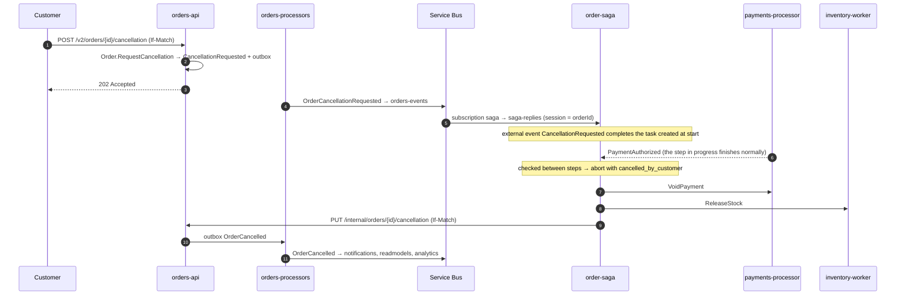

# 03. The customer cancels while the saga is running

The customer clicks "Cancel order" a few seconds after placing it. The saga may be anywhere: waiting for stock, in
the middle of 3-D Secure, or about to confirm. Two writers (the customer through orders-api and the saga) race for
the same order, and the design must produce exactly one outcome.

Patterns: [optimistic concurrency](../architecture/patterns.md#optimistic-concurrency-etag),
[saga orchestration](../architecture/patterns.md#saga-orchestration),
[compensating transaction](../architecture/patterns.md#compensating-transaction),
[transactional outbox](../architecture/patterns.md#transactional-outbox).

## Sequence (cancellation arrives during step 2)



## Steps

| # | Where | What happens | Code | Data / message |
|---|---|---|---|---|
| 1 | `orders-api` | `POST /v2/orders/{id}/cancellation` requires `If-Match` with the ETag the customer last saw (428 when missing, 412 when the order changed). `Order.RequestCancellation` is allowed only from `Submitted`; a repeat in `CancellationRequested` succeeds without effect. | [PublicOrderEndpoints.cs](../../src/Services/Orders/ShopFlow.Orders.Api/Endpoints/PublicOrderEndpoints.cs) `RequestCancellation`, [OrderOperations.cs](../../src/Services/Orders/ShopFlow.Orders.Application/Orders/OrderOperations.cs) `RequestCancellationHandler`, [Order.cs](../../src/Services/Orders/ShopFlow.Orders.Domain/Orders/Order.cs) `RequestCancellation` | Cosmos `orders/orders` (ETag check) + outbox `OrderCancellationRequested` |
| 2 | `orders-processors` | The relay publishes the event; the `orders-events/saga` subscription forwards it to `saga-replies`, so it is ordered with the participants' replies of the same order (session = `orderId`). | [OrdersOutboxRelayFunction.cs](../../src/Services/Orders/ShopFlow.Orders.Processors/Functions/OrdersOutboxRelayFunction.cs) | `OrderCancellationRequested` → `saga-replies` |
| 3 | `order-saga` | The orchestrator created a `WaitForExternalEvent("CancellationRequested")` task at the start. The event completes it, but the step in progress is **not interrupted** (cutting off 3-D Secure halfway would leave the payment in an unknown state). | [OrderSagaWorkflow.cs](../../src/Services/OrderSaga/ShopFlow.OrderSaga/Workflow/OrderSagaWorkflow.cs) `_cancellation`, `CancellationRequested` | DTS history |
| 4 | `order-saga` | After the current step finishes, the saga checks the flag and aborts with `cancelled_by_customer`: compensations in reverse order (`VoidPayment`, then `ReleaseStock`), each state-tolerant. | `OrderSagaWorkflow.AbortAsync`, `RunCompensationsAsync` | commands to `payments-commands`, `inventory-commands` |
| 5 | `order-saga` → `orders-api` | Activity `CompleteOrderCancellation`: `PUT /internal/orders/{id}/cancellation` with `If-Match`. Orders moves `CancellationRequested → Cancelled` and publishes `OrderCancelled`. The saga ends as `Cancelled`. | [OrdersApiClient.cs](../../src/Services/OrderSaga/ShopFlow.OrderSaga/Activities/OrdersApiClient.cs), `SagaOrderOperations.CompleteCancellationAsync` | outbox `OrderCancelled` |
| 6 | `notifications-processor`, `readmodels-projections` | Cancellation e-mail; the customer's order view shows "Cancelled". | [NotificationHandlers.cs](../../src/Services/Notifications/ShopFlow.Notifications.Application/NotificationHandlers.cs), [CustomerOrderView.cs](../../src/Services/CustomerReadModels/ShopFlow.CustomerReadModels.Application/CustomerOrderView.cs) | `OrderCancelled` |

## The race with the confirmation

The interesting case is a cancellation that reaches Orders **after** step 4 (capture) but **before** the saga's
`ConfirmOrder` call, while its event has not reached the saga yet.

| Time | Orders | Saga |
|---|---|---|
| t0 | order `Submitted`, ETag `"e1"` | capture succeeded, about to confirm |
| t1 | customer's cancellation applied: `CancellationRequested`, ETag `"e2"` | — |
| t2 | — | `GET` order → ETag `"e2"`, `PUT .../confirmation` with `If-Match: "e2"` |
| t3 | `Order.Confirm` returns `order.cancellation_pending` → **409** | `OrdersCallOutcome.CancellationPending` → abort with `cancelled_by_customer` |
| t4 | — | compensations: `RefundPayment` (money was captured), `CancelShipment`, `ReleaseStock`; then `CompleteOrderCancellation` |

The opposite order is also safe: if the confirmation wins at t1, the customer's cancellation gets 409 `order.cannot_cancel`
(the order is no longer `Submitted`). The ETag makes sure each writer decides on the state it actually read; the
domain rules decide who wins. Neither side needs a distributed lock.

## Other variants

| Situation | Outcome |
|---|---|
| Cancellation before `ReserveStock` was answered | `ReleaseStock` may overtake the reservation; the tombstone makes a late `ReserveStock` fail ([02](02-payment-declined-compensation.md)). |
| Cancellation after confirmation | 409 `order.cannot_cancel`: a confirmed order is returned through a different (not implemented) process. |
| The customer clicks twice | the second request either sees the new ETag (412) or hits `CancellationRequested` and succeeds without effect; one event in the outbox. |
| The order was closed by back-office meanwhile | the saga compensates without calling Orders again (`notifyOrders: false`). |

## Try it locally

```powershell
dotnet test --project src/Services/Orders/tests/ShopFlow.Orders.UnitTests --filter-class "*OrderTests"
```

```powershell
dotnet test --project src/Services/OrderSaga/tests/ShopFlow.OrderSaga.UnitTests --filter-class "*OrderSagaWorkflowTests"
```

[OrderOperationsTests.cs](../../src/Services/Orders/tests/ShopFlow.Orders.UnitTests/Application/OrderOperationsTests.cs)
covers the 412/409 behavior of the internal operations;
[OrdersApiClientTests.cs](../../src/Services/OrderSaga/tests/ShopFlow.OrderSaga.UnitTests/OrdersApiClientTests.cs) the
saga's side of the conversation.
