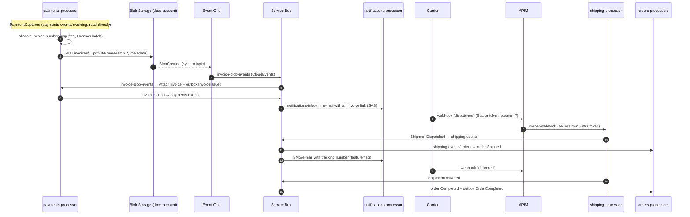

# 04. After confirmation: invoice, dispatch and delivery

The saga is done; from here the contexts react to each other's events without a coordinator. Payments issues the
invoice, the carrier picks up the parcel and later delivers it, Orders completes the order, and Notifications tells
the customer at each step.

Patterns: [choreography](../architecture/patterns.md#choreography),
[blob + Event Grid as a file outbox](../architecture/patterns.md#claim-check-and-file-outbox),
[valet key](../architecture/patterns.md#valet-key-user-delegation-sas),
[gateway offloading](../architecture/patterns.md#gateway-offloading-partner-authentication),
[idempotent side effects](../architecture/patterns.md#idempotent-side-effects-outside-the-database),
[retry vs. dead letter](../architecture/patterns.md#retry-vs-dead-letter).

## Sequence



## Invoice (Blob Storage as an outbox for files)

| # | Where | What happens | Code | Data / message |
|---|---|---|---|---|
| 1 | `payments-processor` (`payments-invoicing`) | Reads the `invoicing` subscription directly (no forward queue). The invoice number is allocated gap-free with a `TransactionalBatch` in a synthetic partition `invoice-numbers:yyyy-MM`. | [PaymentMessagingFunctions.cs](../../src/Services/Payments/ShopFlow.Payments.Functions/Functions/PaymentMessagingFunctions.cs), [InvoicingServices.cs](../../src/Services/Payments/ShopFlow.Payments.Application/Invoicing/InvoicingServices.cs) `InvoiceGenerationHandler`, [CosmosPaymentStores.cs](../../src/Services/Payments/ShopFlow.Payments.Infrastructure/Cosmos/CosmosPaymentStores.cs) | Cosmos `payments` (counter documents) |
| 2 | `payments-processor` | The PDF is rendered (a minimal PDF without third-party libraries) and uploaded with `If-None-Match: *` and metadata `orderId`, `paymentId`, `invoiceNumber`. A retry after a crash finds the blob already there instead of overwriting it. | [InvoiceInfrastructure.cs](../../src/Services/Payments/ShopFlow.Payments.Infrastructure/Invoicing/InvoiceInfrastructure.cs) | blob `invoices/...pdf` in `stshopflowdocs<env>weu` |
| 3 | Event Grid (system topic on the storage account) | `BlobCreated` filtered to `/containers/invoices/` and `.pdf` is delivered to a Service Bus queue as a CloudEvent, using the system topic's managed identity (Data Sender on that queue only). | [eventgrid-invoices.bicep](../../infra/modules/messaging/eventgrid-invoices.bicep) | queue `invoice-blob-events` |
| 4 | `payments-processor` (`invoice-blob-events`) | Reads the blob metadata and registers the invoice: `Payment.AttachInvoice` + outbox `InvoiceIssued` in one Cosmos batch. A correction invoice uploaded manually by back-office takes exactly the same path. | [InvoiceBlobEventsFunction.cs](../../src/Services/Payments/ShopFlow.Payments.Functions/Functions/InvoiceBlobEventsFunction.cs), `InvoiceRegistrationService` | `InvoiceIssued` → `payments-events` |
| 5 | `notifications-processor` | The e-mail contains a link built as a **user delegation SAS** (signed with a key obtained by the managed identity, not the account key) on the Front Door host `files.shopflow.example`, because the storage account has no public endpoint. | [NotificationHandlers.cs](../../src/Services/Notifications/ShopFlow.Notifications.Application/NotificationHandlers.cs) (port `IInvoiceLinks`), [BlobReadLinkFactory.cs](../../src/BuildingBlocks/ShopFlow.Azure/Storage/BlobReadLinkFactory.cs) | ACS Email |

**Why a file outbox:** writing a blob and publishing a message cannot share a transaction. Making the blob itself
the trigger (Event Grid on `BlobCreated`) means "the file exists" and "the event is published" can never disagree.

## Dispatch and delivery (choreography)

| # | Where | What happens | Code | Data / message |
|---|---|---|---|---|
| 6 | Carrier → Front Door → APIM | The carrier does not sign its webhooks; it sends a fixed token. APIM checks the partner IP range and the `Authorization` header against a Key Vault named value, removes the token and calls the function with **its own** Entra ID token (app role `Carrier.Webhooks.Write`). | [carrier-webhook.xml](../../infra/apim/policies/carrier-webhook.xml) | — |
| 7 | `shipping-processor` (`carrier-webhook`) | Easy Auth admits only valid tokens; the code checks the role, deduplicates the webhook and updates the shipment; the outbox gets `ShipmentDispatched` / `ShipmentDelivered`. | [ShippingFunctions.cs](../../src/Services/Shipping/ShopFlow.Shipping.Functions/ShippingFunctions.cs), [EasyAuthPrincipal.cs](../../src/BuildingBlocks/ShopFlow.Functions/EasyAuthPrincipal.cs), [Shipment.cs](../../src/Services/Shipping/ShopFlow.Shipping.Domain/Shipment.cs) | Cosmos `shipping/shipments` → `shipping-events` |
| 8 | `orders-processors` (`shipment-events`) | Reads the `shipping-events/orders` subscription directly (SQL filter for the two event types; Data Receiver on this subscription only). `ShipmentDispatched` moves the order to `Shipped`; `ShipmentDelivered` to `Completed` and publishes `OrderCompleted`. A duplicate changes nothing and is not saved. | [ShipmentEventsFunction.cs](../../src/Services/Orders/ShopFlow.Orders.Processors/Functions/ShipmentEventsFunction.cs), [ShipmentEventHandlers.cs](../../src/Services/Orders/ShopFlow.Orders.Application/Shipping/ShipmentEventHandlers.cs) | Cosmos `orders/orders` + outbox `OrderCompleted` |
| 9 | `notifications-processor` | Dispatch e-mail, plus an SMS for customers targeted by the `Notifications.ShipmentSms` feature flag (percentage targeting by customer id hash). The send is made idempotent with a log document: reserve → send with an operation id → record the result. SMS is "at most once": a lost SMS breaks nothing (the e-mail already went out), while a duplicate costs money. | [NotificationSender.cs](../../src/Services/Notifications/ShopFlow.Notifications.Application/NotificationSender.cs), [CommunicationChannels.cs](../../src/Services/Notifications/ShopFlow.Notifications.Infrastructure/Channels/CommunicationChannels.cs), [CosmosNotificationLog.cs](../../src/Services/Notifications/ShopFlow.Notifications.Infrastructure/Cosmos/CosmosNotificationLog.cs) | Cosmos `notifications`, ACS Email/SMS |

## The same domain refusal, two different decisions

`ShipmentEventSupport.ApplyAsync` turns the domain result into a broker decision:

| Domain result | Meaning | Exception | Broker outcome |
|---|---|---|---|
| order not found | the order document is not visible to this reader yet | `OutOfOrderMessageException` | retry (transient) |
| `order.not_confirmed_yet` | the shipment event overtook the saga's confirmation | `OutOfOrderMessageException` | retry; the message comes back once the order is confirmed |
| `order.closed` (rejected/cancelled order) | a shipment exists for an order that must not ship | `PermanentMessageException` (`BusinessRuleViolation`) | DLQ immediately, a human investigates ([05](05-poison-message-and-replay.md)) |

## Labels for the warehouse

`GET /api/shipments/{orderId}/{shipmentId}/label` (`shipment-label`, role `Warehouse.Operator`) answers with a 302
redirect to a user delegation SAS valid for 15 minutes, on the Front Door files host. The function never streams the
file itself: the [valet key](../architecture/patterns.md#valet-key-user-delegation-sas) lets the client fetch it
directly from storage.

## Try it locally

```powershell
dotnet test --project src/Services/Orders/tests/ShopFlow.Orders.UnitTests --filter-class "*ShipmentEventHandlersTests"
```

```powershell
dotnet test --project src/Services/Payments/tests/ShopFlow.Payments.UnitTests --filter-class "*InvoiceTests"
```

See also [ShippingTests.cs](../../src/Services/Shipping/tests/ShopFlow.Shipping.UnitTests/ShippingTests.cs),
[BlobReadLinkFactoryTests.cs](../../src/BuildingBlocks/tests/ShopFlow.BuildingBlocks.Tests/Storage/BlobReadLinkFactoryTests.cs)
and [NotificationHandlerTests.cs](../../src/Services/Notifications/tests/ShopFlow.Notifications.UnitTests/NotificationHandlerTests.cs).
