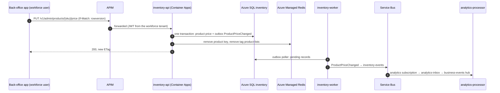

# 06. Back-office changes a price

A category manager lowers the price of a product. The change must not overwrite a concurrent edit, the product page
must show the new price quickly, checkout must use the new price immediately, and analytics must hear about it.
This scenario shows the **SQL** variant of the outbox and the caching strategy of the catalog.

Patterns: [optimistic concurrency](../architecture/patterns.md#optimistic-concurrency-etag),
[cache-aside with HybridCache](../architecture/patterns.md#cache-aside-with-bounded-staleness),
[transactional outbox (SQL + poller)](../architecture/patterns.md#transactional-outbox),
[denormalized snapshot](../architecture/patterns.md#denormalized-snapshot-in-the-aggregate).

## Sequence



## Steps

| # | Where | What happens | Code | Data / message |
|---|---|---|---|---|
| 1 | APIM → `inventory-api` | The admin route requires a workforce (employee) token with the catalog manager app role; customer tokens from External ID are rejected. | [InventoryEndpoints.cs](../../src/Services/Inventory/ShopFlow.Inventory.Api/Endpoints/InventoryEndpoints.cs) `/v1/admin/products/{sku}/price` (`InventoryPolicies.CatalogManager`), [catalog.xml](../../infra/apim/policies/catalog.xml) | — |
| 2 | `inventory-api` | `If-Match` must equal the product row's `rowversion` (exposed as the ETag). A mismatch throws `ConcurrencyConflictException` → 412: someone else changed the product since the manager loaded it. | [BackofficeOperations.cs](../../src/Services/Inventory/ShopFlow.Inventory.Application/Catalog/BackofficeOperations.cs) `ChangePriceAsync`, [ConcurrencyHttpExtensions.cs](../../src/BuildingBlocks/ShopFlow.Web/Http/ConcurrencyHttpExtensions.cs) | Azure SQL `Products` |
| 3 | `inventory-api` | `Product.ChangePrice` validates the price (business rules return `Result` errors). `InventoryEventPublisher` adds `ProductPriceChanged` to the outbox; EF Core saves the product and the outbox row in **one transaction**. SQL re-checks the rowversion on `UPDATE`, so a race between two requests that both passed step 2 still fails one of them. | [Product.cs](../../src/Services/Inventory/ShopFlow.Inventory.Domain/Catalog/Product.cs), [InventoryEventPublisher.cs](../../src/Services/Inventory/ShopFlow.Inventory.Application/InventoryEventPublisher.cs), [CatalogConfigurations.cs](../../src/Services/Inventory/ShopFlow.Inventory.Infrastructure/Persistence/Configurations/CatalogConfigurations.cs) | `Products`, `messaging.OutboxMessages` |
| 4 | `inventory-api` | **After** the commit, the cache is invalidated: the product entry (L1 of this replica and Redis) and every product list by tag. In the opposite order, another request could read the old price from SQL in between and put it back. | [CatalogReaders.cs](../../src/Services/Inventory/ShopFlow.Inventory.Infrastructure/Catalog/CatalogReaders.cs) `CachedCatalogReader.InvalidateProductAsync` | Redis key `inventory:product:{SKU}`, tag `product-lists` |
| 5 | Other `inventory-api` replicas | They may still serve the old price from their **L1** (process memory) for up to 30 seconds (`LocalCacheExpiration`). This bounded staleness is a deliberate trade-off for product pages. | `CachedCatalogReader` | — |
| 6 | `orders-api` (next checkout) | Checkout prices never come from the HybridCache: `/internal/catalog/prices` reads SQL directly, so the next order uses the new price at once. Orders already placed keep the price copied into their order lines. | [SubmitOrder.cs](../../src/Services/Orders/ShopFlow.Orders.Application/Orders/SubmitOrder.cs), [OrderLine.cs](../../src/Services/Orders/ShopFlow.Orders.Domain/Orders/OrderLine.cs) | — |
| 7 | `inventory-worker` (background service) | `inventory-api` runs no poller (`runOutboxPoller: false`), so its outbox rows are published by the worker's next polling run (`PollingInterval`, 5 s); the worker's own writes wake its poller at once through `IOutboxSignal`. Each replica **claims** a batch (`ClaimedUntil`) so two replicas never send the same rows; a crashed replica's claim expires. `MessageId` = outbox row id; published rows are purged in chunks. | [SqlOutboxPollerService.cs](../../src/BuildingBlocks/ShopFlow.Persistence.SqlServer/Messaging/SqlOutboxPollerService.cs), [SqlOutboxRelay.cs](../../src/BuildingBlocks/ShopFlow.Persistence.SqlServer/Messaging/SqlOutboxRelay.cs), [OutboxSignal.cs](../../src/BuildingBlocks/ShopFlow.Persistence.SqlServer/Messaging/OutboxSignal.cs), [Worker/Program.cs](../../src/Services/Inventory/ShopFlow.Inventory.Worker/Program.cs) | `ProductPriceChanged` → `inventory-events` |
| 8 | Service Bus → `analytics-processor` | Only the `analytics` subscription (no filter) receives it; the forwarder puts it on the `business-events` hub ([08](08-clickstream-analytics.md)). | [IngestFunctions.cs](../../src/Services/Analytics/ShopFlow.Analytics.Functions/IngestFunctions.cs) `business-events-forwarder` | `analytics-inbox` → Event Hubs `business-events` |

## Cosmos outbox vs. SQL outbox

| | Cosmos DB (Orders, Payments, Shipping) | Azure SQL (Inventory) |
|---|---|---|
| Atomic write | `TransactionalBatch` in one logical partition | one database transaction |
| Who notices new records | Change Feed trigger (push, lease container) | an in-process signal after `SaveChanges` plus polling every 5 s (`SqlOutboxPollerService`) |
| Where the relay runs | a Functions app (`*-outbox-relay`) | `inventory-worker` |
| Ordering | per partition (= per aggregate) | within a claimed batch only; replicas may publish batches out of order (consumers tolerate it) |
| Cleanup | TTL on outbox documents | purge job in chunks |

Both give the same guarantee: an event is published if and only if the state change was committed, at least once,
with a stable `MessageId`. See [ADR-0009](../adr/0009-outbox-and-inbox.md).

## Try it locally

```powershell
dotnet test --project src/Services/Inventory/tests/ShopFlow.Inventory.UnitTests --filter-class "*BackofficeOperationsTests"
```

```powershell
dotnet test --project src/Services/Inventory/tests/ShopFlow.Inventory.Api.Tests
```

With Docker running, [InventorySqlTests.cs](../../src/Services/Inventory/tests/ShopFlow.Inventory.IntegrationTests/InventorySqlTests.cs)
exercises the real SQL Server (Testcontainers), including rowversion conflicts and the outbox table.
