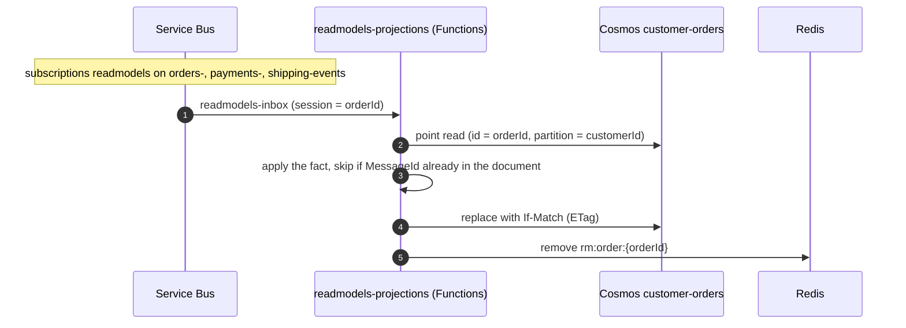

# 07. The customer opens "My orders"

Right after placing an order the customer is redirected to the order page, and later browses the order history.
Neither request touches the Orders write model: a separate read side (CQRS) keeps one document per order, built from
events of three contexts, in the customer's partition.

Patterns: [CQRS](../architecture/patterns.md#cqrs-and-materialized-view),
[order-tolerant projection](../architecture/patterns.md#order-tolerant-projection),
[read your writes](../architecture/patterns.md#read-your-writes-with-uuid-v7),
[idempotent receiver](../architecture/patterns.md#idempotent-receiver),
[cache-aside](../architecture/patterns.md#cache-aside-with-bounded-staleness).

## Writing the view (projection)



| # | Where | What happens | Code | Data / message |
|---|---|---|---|---|
| 1 | Service Bus | Three topics feed one queue: the `readmodels` subscriptions (no filter) on `orders-events`, `payments-events` and `shipping-events` forward to the session-enabled `readmodels-inbox`. | [messaging-topology.json](../../infra/modules/messaging/messaging-topology.json) | `readmodels-inbox` |
| 2 | `readmodels-projections` (`customer-orders-projection`) | Session trigger: messages of one order are processed one at a time, different orders in parallel. One handler class is registered for 17 contract types. | [ProjectionFunctions.cs](../../src/Services/CustomerReadModels/ShopFlow.CustomerReadModels.Projections/ProjectionFunctions.cs), [ProjectionHandlers.cs](../../src/Services/CustomerReadModels/ShopFlow.CustomerReadModels.Application/ProjectionHandlers.cs) | — |
| 3 | same | The projector loads the view and applies the event as a **fact** (`ConfirmedAt`, `DispatchedAt`, …); the status is derived from the facts, so a `ShipmentDispatched` that arrives before `OrderConfirmed` cannot move the status backwards later. | [ReadModelsApplication.cs](../../src/Services/CustomerReadModels/ShopFlow.CustomerReadModels.Application/ReadModelsApplication.cs) `CustomerOrderProjector`, [CustomerOrderView.cs](../../src/Services/CustomerReadModels/ShopFlow.CustomerReadModels.Application/CustomerOrderView.cs) | — |
| 4 | same | **Inbox inside the document:** the view keeps the last processed `MessageId`s (`AppliedMessageIds`). The view change and the inbox entry are one write of one document, so they are atomic without a batch. | `CustomerOrderView.AppliedMessageIds` | — |
| 5 | same → Cosmos | Create or replace with `If-Match`; a 409/412 (a concurrent writer) becomes `ConcurrencyConflictException`, a transient failure, and the message is retried. The projection lag (event time → stored) is recorded as a metric; alert `projection-lag` fires when p95 > 60 s. | [CosmosCustomerOrderStore.cs](../../src/Services/CustomerReadModels/ShopFlow.CustomerReadModels.Infrastructure/CosmosCustomerOrderStore.cs) | Cosmos `readmodels/customer-orders` (partition `/customerId`), metric `shopflow.readmodels.projection_lag` |
| 6 | same → Redis | The cached copy of the order details is removed after the write. | `CustomerOrderProjector` | Redis `rm:order:{orderId}` |

## Reading the view

| # | Where | What happens | Code | Data |
|---|---|---|---|---|
| 7 | APIM → `readmodels-api` (Container Apps) | `GET /v1/me/orders/{orderId}`: there is no customer id in the URL. It comes from the token, so a customer cannot ask for someone else's orders. | [CustomerOrderEndpoints.cs](../../src/Services/CustomerReadModels/ShopFlow.CustomerReadModels.Api/CustomerOrderEndpoints.cs), [customer-api.xml](../../infra/apim/policies/customer-api.xml) | — |
| 8 | `readmodels-api` | Redis first; a cached document is returned only if its `CustomerId` matches the caller (the cache key has no customer id). Otherwise a **point read with the caller's partition key**: authorization by partition. | `CustomerOrderQueries.GetAsync` in [ReadModelsApplication.cs](../../src/Services/CustomerReadModels/ShopFlow.CustomerReadModels.Application/ReadModelsApplication.cs) | Redis `rm:order:{id}` (60 s TTL), Cosmos point read |
| 9 | `readmodels-api` | **Read your writes:** if the document does not exist yet but the order id (UUID v7) was created a moment ago, the answer is 404 with `Retry-After: 2` and a dedicated problem type ("projection pending"), not a plain 404. The client polls; an old unknown id is a real 404. | `UuidV7.TryGetTimestamp`, `ProjectionPending` | — |
| 10 | `readmodels-api` | `Cache-Control: private, no-cache`: shared caches (APIM, Front Door, corporate proxies) must not store one customer's order for another. | `CustomerOrderEndpoints.GetAsync` | — |
| 11 | `readmodels-api` | `GET /v1/me/orders?continuationToken=…`: a single-partition query with `MaxItemCount`; the Cosmos continuation token is returned base64url-encoded. A tampered token is rejected as a bad request. | `CosmosCustomerOrderStore.ListAsync`, `EncodeToken`/`DecodeToken` | Cosmos query within the customer's partition |
| 12 | `readmodels-api` | `GET /v1/me/orders/{id}/invoice` returns a short-lived user delegation SAS link to the PDF (scenario [04](04-shipping-delivery-invoice.md)). | `GetInvoiceLinkAsync`, [BlobReadLinkFactory.cs](../../src/BuildingBlocks/ShopFlow.Azure/Storage/BlobReadLinkFactory.cs) | Blob `invoices` via Front Door |

## Why a read model at all

The Orders write model is partitioned by `/orderId` (atomic writes of one order with its outbox). "All orders of
customer X" would be a cross-partition query there, and it would also need payment and shipping data that Orders does
not own. The read model is partitioned by `/customerId` and denormalizes the three sources, so both screens are a point
read or a single-partition query. The price: eventual consistency (seconds), handled explicitly in step 9.
See [ADR-0007](../adr/0007-cosmos-partition-keys.md).

## Rebuilding

The view can be thrown away and rebuilt: replay the events into `readmodels-inbox` (Event Hubs Capture archive or DLQ
replay). Idempotency (inbox in the document) and order tolerance (facts) are exactly what makes a rebuild safe. A view
shape change raises `SchemaVersion`; old documents are recomputed lazily on the next event.

## Try it locally

```powershell
dotnet test --project src/Services/CustomerReadModels/tests/ShopFlow.CustomerReadModels.UnitTests
```

```powershell
dotnet test --project src/Services/CustomerReadModels/tests/ShopFlow.CustomerReadModels.Api.Tests
```

[ProjectionTests.cs](../../src/Services/CustomerReadModels/tests/ShopFlow.CustomerReadModels.UnitTests/ProjectionTests.cs)
applies events in different orders and twice, and checks that the view ends up the same.
