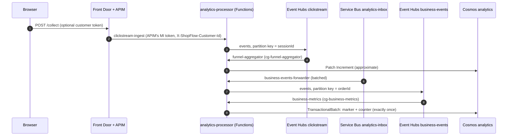

# 08. Clickstream and revenue metrics (Event Hubs)

Two streams with different rules. Browsers send thousands of anonymous click events per second: volume and replay
matter, an occasional double count does not. Business events (orders, payments) are few, but they are money: every one
must be counted exactly once. Both go through Event Hubs, not Service Bus.

Patterns: [event streaming with partitions](../architecture/patterns.md#event-streaming-and-partitioning),
[gateway offloading](../architecture/patterns.md#gateway-offloading-partner-authentication),
[exactly-once aggregation](../architecture/patterns.md#exactly-once-effect-with-a-marker),
[competing consumers vs. consumer groups](../architecture/patterns.md#competing-consumers).

## Sequence



## Clickstream (approximate, high volume)

| # | Where | What happens | Code | Data / message |
|---|---|---|---|---|
| 1 | Front Door + APIM | `/collect` is public, so APIM does the security work: it **removes** any client-sent `X-ShopFlow-Customer-Id`, validates an External ID token if present and writes its `oid` into that header, rate-limits per IP and caps the body size, then calls the function with its own managed identity token. | [clickstream.xml](../../infra/apim/policies/clickstream.xml), `ClickstreamIngestFunction` remarks | — |
| 2 | `analytics-processor` (`clickstream-ingest`, HTTP) | Easy Auth admits only APIM's identity (role `Analytics.Ingest`). The ingestor validates and sanitizes events: query parameters that may carry personal data (e-mail, tokens) are stripped from page URLs. | [IngestFunctions.cs](../../src/Services/Analytics/ShopFlow.Analytics.Functions/IngestFunctions.cs), [Clickstream.cs](../../src/Services/Analytics/ShopFlow.Analytics.Application/Clickstream.cs) | — |
| 3 | same → Event Hubs | Events are sent with partition key `sessionId`: one browsing session lands in one partition, in order. 8 partitions, 24 h retention, Capture to ADLS Gen2 (the cold path). | [EventHubsPublishers.cs](../../src/Services/Analytics/ShopFlow.Analytics.Infrastructure/EventHubsPublishers.cs), [eventhubs.bicep](../../infra/modules/messaging/eventhubs.bicep) | hub `clickstream` |
| 4 | `analytics-processor` (`funnel-aggregator`, Event Hubs trigger) | Consumer group `cg-funnel-aggregator`, its own checkpoints. One-minute funnel counters updated with Cosmos **Patch Increment** (no read-modify-write). A repeated batch counts twice: accepted for a conversion trend. | [AggregationFunctions.cs](../../src/Services/Analytics/ShopFlow.Analytics.Functions/AggregationFunctions.cs), [CosmosMetricStore.cs](../../src/Services/Analytics/ShopFlow.Analytics.Infrastructure/CosmosMetricStore.cs) | Cosmos `analytics/aggregates` (partition `/metricId`) |

## Business events (exact, money)

| # | Where | What happens | Code | Data / message |
|---|---|---|---|---|
| 5 | Service Bus | The `analytics` subscriptions (no filter) on all four topics forward every business event to `analytics-inbox`. | [messaging-topology.json](../../infra/modules/messaging/messaging-topology.json) | `analytics-inbox` |
| 6 | `analytics-processor` (`business-events-forwarder`, batched Service Bus trigger) | Takes a batch, writes it to Event Hubs in a few sends (partition key `orderId`), and completes the messages **only after** the write. A failed write abandons the whole batch, so the hub receives "at least once". A malformed message is dead-lettered without blocking the batch. | `BusinessEventsForwarderFunction` in [IngestFunctions.cs](../../src/Services/Analytics/ShopFlow.Analytics.Functions/IngestFunctions.cs), [BusinessEvents.cs](../../src/Services/Analytics/ShopFlow.Analytics.Application/BusinessEvents.cs) | hub `business-events` (4 partitions, 72 h, Capture) |
| 7 | `analytics-processor` (`business-metrics`, Event Hubs trigger) | Consumer group `cg-business-metrics`. For each event, a **marker document** (the event id) and the counter increment are written in one `TransactionalBatch`; a duplicate gets 409 on the marker, which rolls back the whole batch, so revenue is counted exactly once. | `AggregationFunctions` (`business-metrics`), `CosmosMetricStore.ApplyOnceAsync` | Cosmos `analytics/aggregates` (marker + counter in the window's partition) |
| 8 | `analytics-processor` (`metrics-query`, HTTP) | Back-office reads per-minute metrics. | `MetricsQueryFunction` | — |

## Event Hubs vs. Service Bus here

| Concern | Event Hubs (this scenario) | Service Bus (the rest of ShopFlow) |
|---|---|---|
| Delivery state | a checkpoint per partition and consumer group; the reader moves the cursor | per message: lock, complete, abandon, DLQ |
| A failed batch | the checkpoint moves on after the function returns, even after an exception; `ExponentialBackoffRetry` holds it for a few attempts, then the batch is lost for the hot path (still in Capture) | redelivered up to `maxDeliveryCount`, then DLQ |
| Several independent readers | consumer groups, each with its own cursor | one subscription per reader |
| Replay | rewind the checkpoint or read the Capture archive | DLQ replay of individual messages |

That is why the hot path tolerates approximation for clicks and uses an explicit dedupe marker for money: Event Hubs
gives "at least once" with no per-message settlement.

## Try it locally

```powershell
dotnet test --project src/Services/Analytics/tests/ShopFlow.Analytics.UnitTests
```

[AnalyticsTests.cs](../../src/Services/Analytics/tests/ShopFlow.Analytics.UnitTests/AnalyticsTests.cs) covers the customer id
coming only from the token, URL sanitizing, rejecting bad events one by one, money in minor units and per-minute summing.
