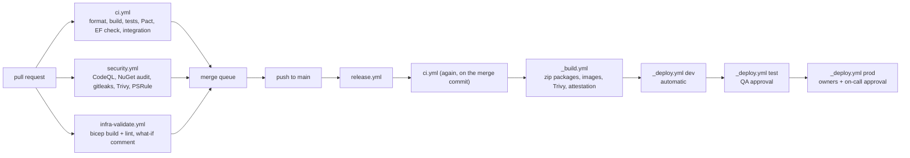

# 09. A merge to main reaches production

A developer merges a pull request that changes `payments-processor` and one Bicep module. This walkthrough follows
the change from the pull request checks to production, showing what runs on GitHub, what runs in Azure, and which
identity is used at each step.

> Documentation only. In this learning repository nothing is pushed or deployed; the workflows are read, not run.

Patterns: [build once, deploy many](../architecture/patterns.md#build-once-deploy-many),
[workload identity federation (OIDC)](../architecture/patterns.md#workload-identity-federation-oidc),
[deployment strategies](../architecture/patterns.md#deployment-strategies-slots-revisions-rolling-update),
[expand/contract migrations](../architecture/patterns.md#expand-contract-schema-migrations).

## Overview



## Pull request (GitHub-hosted runners, no Azure write access)

| # | Workflow / job | What happens | Identity |
|---|---|---|---|
| 1 | [ci.yml](../../.github/workflows/ci.yml) `build-and-test` | Restore, `dotnet format` check, Release build (warnings are errors), tests without Pact, Pact consumers → check that pact files did not change → Pact providers, `dotnet ef migrations has-pending-model-changes`. Locally: [scripts/verify.ps1](../../scripts/verify.ps1). | none (no cloud) |
| 2 | ci.yml `integration-tests` | Only for the deployable units touched by the change ([filters.yml](../../.github/filters.yml)): Testcontainers with SQL Server and the Cosmos DB emulator. | none |
| 3 | [security.yml](../../.github/workflows/security.yml) | CodeQL, NuGet vulnerability audit as a hard gate, dependency review, gitleaks, Trivy on Dockerfiles, PSRule for Azure on Bicep. | none |
| 4 | [infra-validate.yml](../../.github/workflows/infra-validate.yml) | `az bicep build` and `az bicep lint` for every entry and parameter file; what-if against dev posted as one updated PR comment. | `id-shopflow-github-plan-dev-weu`: OIDC subject `pull_request`, Reader + "What-If Reader" only |
| 5 | Branch protection + merge queue | Required statuses (`ci-result`, `bicep build and lint`, CodeQL), CODEOWNERS review (contracts and pacts need architecture approval), `merge_group` runs CI on the queued merge. | — |

## Release (on push to main)

| # | Where | What happens | Code | Identity |
|---|---|---|---|---|
| 6 | GitHub, [release.yml](../../.github/workflows/release.yml) | Calls `ci.yml` again on the merge commit, then `_build.yml`, then `_deploy.yml` three times. | — | — |
| 7 | GitHub, [_build.yml](../../.github/workflows/_build.yml) `packages` | `dotnet publish` of App Service and Functions units into zip packages, uploaded as one workflow artifact (kept 30 days for rollback). Version `1.0.{run_number}`, commit SHA in `InformationalVersion`. | [deployables.json](../../.github/deployables.json) | none |
| 8 | GitHub, `_build.yml` `image` (matrix) | Container images (chiseled .NET base) built with Buildx, **scanned by Trivy before push** (a fixable critical vulnerability never reaches the registry), pushed with the commit SHA as the tag, and given a build provenance attestation. | Dockerfiles in `src/Services/**` | `id-shopflow-github-build`: OIDC subject `ref:refs/heads/main`, AcrPush on `crshopflowsharedweu` |
| 9 | GitHub runner **inside the environment's VNet** ([_deploy.yml](../../.github/workflows/_deploy.yml)) | The job runs on the runner group `shopflow-<env>` (GitHub-hosted runners with a network interface in the VNet), because App Service and Functions have no public SCM endpoint. One job per environment, so each approval covers the whole deployment. | [azure-login](../../.github/actions/azure-login/action.yml) | `id-shopflow-github-deploy-<env>-weu`: OIDC subject `environment:<env>` |
| 10 | same | **What changed since the last deployment to this environment** (the `deployedCommit` tag on `rg-…-apps`), not since the previous commit: a failed or skipped release is not forgotten. The plan lists infrastructure and units to deploy. | `_deploy.yml` steps "Last deployed commit", "Deployment plan" | Reader on the groups |
| 11 | Azure Resource Manager | Infrastructure (if `infra/` changed): what-if, then `az deployment sub create` of `main.bicep`. `IMAGE_TAGS` are read from the running container apps first, so an infrastructure deployment never rolls applications back to an old image. | [bicep-deploy](../../.github/actions/bicep-deploy/action.yml), [current-image-tags.sh](../../.github/scripts/current-image-tags.sh) | Contributor on the 3 groups, constrained RBAC Administrator |
| 12 | Container Apps Job in the VNet | Database migrations (if Inventory changed): the `inventory-migrations` image (an EF Core bundle) runs as a job against Azure SQL, **before** any new code. Migrations are backward compatible (expand/contract). | [run-migrations](../../.github/actions/run-migrations/action.yml), [Dockerfile.migrations](../../src/Services/Inventory/ShopFlow.Inventory.Infrastructure/Dockerfile.migrations) | `id-…-inventory-migrations`: `db_owner`, used only by this job |
| 13 | Container Apps | `inventory-api`, `inventory-worker`, `readmodels-api`: a new **revision** with the SHA-tagged image; the action waits until the revision is healthy. | [deploy-containerapp](../../.github/actions/deploy-containerapp/action.yml) | deploy identity; apps pull with their own AcrPull identity |
| 14 | App Service | `orders-api`: zip to the **staging slot**, smoke test the slot, **swap** to production, smoke test again. Rollback = swap back. | [deploy-appservice-slot](../../.github/actions/deploy-appservice-slot/action.yml) | deploy identity |
| 15 | Functions Flex Consumption | Changed function apps (here `payments-processor`): zip deployment one app at a time; Flex does a **rolling update**, so old and new code run side by side for minutes (contracts must be compatible both ways). | [deploy-functionapp](../../.github/actions/deploy-functionapp/action.yml) | deploy identity |
| 16 | Front Door → APIM | Smoke test through the public edge: readiness endpoints, and `401` (not `404`/`500`) from protected routes without a token. Read-only, safe in production. | [smoke-test](../../.github/actions/smoke-test/action.yml) | none |
| 17 | Azure Resource Manager | The `deployedCommit` tag is updated: the next release computes its changes from here. | `_deploy.yml` "Record deployed commit" | deploy identity |
| 18 | GitHub environments | `test` waits for QA approval, `prod` for product owners + on-call. The same packages and image digests are deployed: nothing is rebuilt. | — | per-environment identities |

## Rolling back

[rollback.yml](../../.github/workflows/rollback.yml) (manual): `orders-api` swaps the slots back; a container app gets
the previous image tag. Infrastructure is not rolled back automatically: reverting a Bicep change is a new pull
request. Procedure: [deployment-rollback runbook](../runbooks/deployment-rollback.md); strategies:
[ADR-0014](../adr/0014-deployment-strategies.md).

## Why this shape

- **No secrets in GitHub:** every Azure sign-in is an OIDC token exchanged for a managed identity that trusts exactly
  one subject (branch, pull request or environment). A compromised dev deployment cannot touch prod.
- **The pipeline cannot escalate:** it may grant only the roles listed in `delegableRoles`; the bootstrap (run by an
  administrator) owns everything else ([infra/README.md](../../infra/README.md)).
- **Build once:** the artifact that passed test is byte-for-byte the one in prod; attestation proves where it was built.

## Try it locally

The cloud-free part of the PR checks:

```powershell
./scripts/verify.ps1
```
