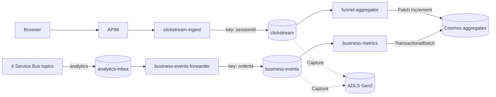

# analytics-processor

Azure Functions (isolated worker, .NET 10), **Flex Consumption** plan, VNet.

| Function | Trigger | Role |
|---|---|---|
| `clickstream-ingest` | HTTP `POST /api/clickstream` through APIM | validating and sanitizing browser events, writing to the `clickstream` hub |
| `business-events-forwarder` | queue `analytics-inbox`, batched | forwarding integration events to the `business-events` hub |
| `funnel-aggregator` | hub `clickstream`, group `cg-funnel-aggregator` | conversion funnel per minute (approximate) |
| `business-metrics` | hub `business-events`, group `cg-business-metrics` | orders, revenue, refunds, rejection reasons per minute (exact) |
| `metrics-query` | HTTP `GET /api/metrics/{funnel\|business}` | reading aggregates for the dashboard (role `Analytics.Reader`) |

What to look at:

- **Service Bus and Event Hubs in one process.** The same app reads a queue (messages acknowledged one by one, DLQ, redelivery) and hubs (a partition log with a checkpoint, no DLQ). An exception in a function with an Event Hubs trigger does not roll back the checkpoint, which is why the aggregating functions have an `ExponentialBackoffRetry` policy.
- **Two guarantees for two streams.** The funnel counts "at least once" (`Patch` with `Increment`, an acceptable approximation). The business metrics count every event exactly once: the event marker and the counter increment are in one `TransactionalBatch`.
- **Pre-aggregation in the batch's memory.** One write per window per batch, not per event, protects the one-minute logical partition from 429s.
- **Event time, not processing time,** with limited trust in the browser's clock.
- **Untrusted input from the internet.** `CustomerId` comes only from the token (APIM writes it into a header after removing the client's header). Page URLs lose their query parameters except `utm_*`, because the Capture archive lives for years.
- **The forwarder does not know contract types.** The payload passes through as JSON, so new events reach analytics without deploying this app.
- **`initialOffsetOptions: fromEnd`.** A new consumer group (first deployment, no checkpoints) starts from current events instead of catching up on the hub's whole retention. History is recomputed from Capture.
- **Scaling limited by the number of partitions.** Within one consumer group a partition is read by one reader at a time, so `clickstream` (8 partitions) gives at most 8 parallel aggregator instances. The partition count in the Standard tier cannot be changed later.

| Setting | Example |
|---|---|
| `EventHubs__fullyQualifiedNamespace` | `evhns-shopflow-prod-weu.servicebus.windows.net` (producers and triggers) |
| `ServiceBus__fullyQualifiedNamespace` | `sbns-shopflow-prod-weu.servicebus.windows.net` |
| `Cosmos__accountEndpoint`, `Cosmos__DatabaseName` | `...`, `analytics` |
| `AzureWebJobsStorage__accountName` | the function host account (Event Hubs checkpoints, with the managed identity) |

Walkthrough: [08-clickstream-analytics.md](../../../../docs/walkthroughs/08-clickstream-analytics.md).
