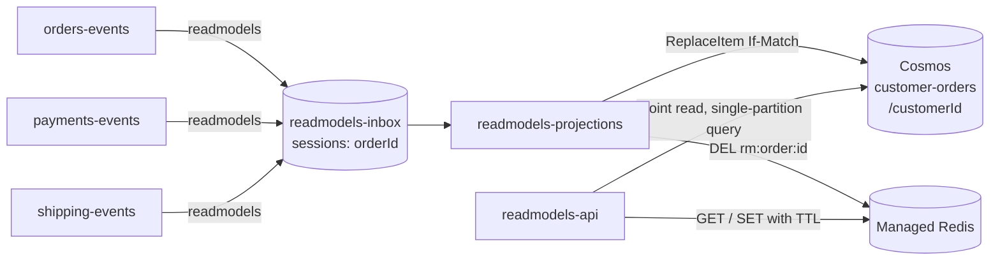

# Customer Read Models

The CQRS read side for the "my orders" and "order details" screens. Two deployable units:

| Unit | Hosting | Role |
|---|---|---|
| `readmodels-projections` | Functions Flex Consumption | the `customer-orders-projection` from the `readmodels-inbox` queue (sessions by `orderId`) |
| `readmodels-api` | Container Apps ([Program.cs](../ShopFlow.CustomerReadModels.Api/Program.cs)) | `GET /v1/me/orders`, `GET /v1/me/orders/{orderId}`, `GET /v1/me/orders/{orderId}/invoice` |

What to look at:

- **Facts instead of the last status** ([CustomerOrderView](../ShopFlow.CustomerReadModels.Application/CustomerOrderView.cs)). Sessions order messages within one queue, but not across three topics. The view stores event dates, and one precedence rule derives the status, so a late `OrderConfirmed` does not move an order back from "shipped".
- **A document without a header.** A payment event may arrive before `OrderSubmitted`. The projector then creates a view without the order number and fills it in later, and the API does not show such views.
- **An inbox inside the document.** The view change and the identifier of the applied message are one write, so they are atomic. This matters for refunds, which add up.
- **Authorization by partition key.** The API looks for the order only in the signed-in customer's partition (`oid` from the token), so someone else's order gives 404. The Redis cache key has no customer, so after a cache read the owner is checked.
- **"Read your writes" thanks to UUID v7.** Right after an order is placed the projection may not have it yet. The creation time stored in the identifier lets the API answer 404 with `Retry-After` and the `projection-pending` problem type instead of a plain "does not exist".
- **Paging with a continuation token**, not OFFSET: every page costs the same RU.
- **The `shopflow.readmodels.projection_lag` metric** measures the lag from the event's occurrence to the view write, across the whole chain (outbox, topic, forward, session).

Limitations to know about:

- A message that lands in the DLQ (e.g. a bug in the projection code) leaves a gap in the view until it is replayed. Later events of the order are projected normally, because the view does not require continuity.
- **Rebuilding the projection** (a new field, a bug in a rule): Service Bus keeps no history. The source is the Event Hubs Capture archive (the Analytics stage). A new container is filled from the archive, and then the API switches to it through a setting in App Configuration. The `schemaVersion` field also allows recomputing documents lazily on the next event.

| Setting | Example |
|---|---|
| `Cosmos__accountEndpoint`, `Cosmos__DatabaseName` | `...`, `readmodels` |
| `ServiceBus__fullyQualifiedNamespace` (projections) | `sbns-shopflow-prod-weu.servicebus.windows.net` |
| `Redis__Endpoint` | `amr-shopflow-prod-weu.westeurope.redis.azure.net:10000` |
| `InvoiceDownloads__serviceUri` (API) | `https://stshopflowdocsprodweu.blob.core.windows.net` |
| `BlobLinks__PublicBaseUrl` (API) | `https://files.shopflow.example` |

Walkthrough: [07-my-orders-read-model.md](../../../../docs/walkthroughs/07-my-orders-read-model.md).
