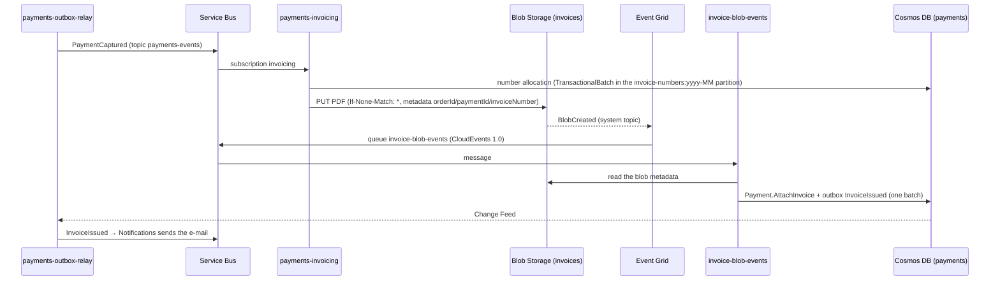

# payments-processor

Azure Functions (isolated worker, .NET 10), **Flex Consumption** plan with VNet integration and a **NAT Gateway**.

| Function | Trigger | Role |
|---|---|---|
| `payment-commands` | the session-enabled queue `payments-commands` | `AuthorizePayment`, `CapturePayment`, `VoidPayment`, `RefundPayment` |
| `psp-webhook` | HTTP `POST /api/webhooks/psp` (through APIM) | the 3-D Secure result from the provider → `PaymentAuthorized` / `PaymentDeclined` |
| `payments-outbox-relay` | Change Feed of the `payments` container | publishing events to `payments-events` |
| `payments-invoicing` | subscription `payments-events/invoicing` | `PaymentCaptured` → invoice number → PDF → Blob Storage |
| `invoice-blob-events` | queue `invoice-blob-events` (fed by Event Grid) | `BlobCreated` → invoice registration → `InvoiceIssued` |

## Invoice flow

## Secrets

This is the only service with application secrets, because the payment provider is external and does not know Entra ID.

| Configuration key (after trimming the `Payments:` prefix) | Source | Rotation |
|---|---|---|
| `Psp:ApiKey` | App Configuration → Key Vault reference `psp-api-key` | a new secret version in Key Vault; the provider refreshes every hour, `IOptionsMonitor` hands out the new value without a restart |
| `Psp:WebhookSecrets:0`, `Psp:WebhookSecrets:1` | as above (`psp-webhook-secret-current`, `psp-webhook-secret-previous`) | two secrets at once during the transition (docs/runbooks/secret-rotation.md) |

The other settings (Cosmos, Service Bus, Storage) are only addresses; the managed identity grants access.

| Setting | Example |
|---|---|
| `Cosmos__accountEndpoint`, `Cosmos__DatabaseName` | `https://cosmos-shopflow-prod-weu.documents.azure.com:443/`, `payments` |
| `ServiceBus__fullyQualifiedNamespace` | `sbns-shopflow-prod-weu.servicebus.windows.net` |
| `InvoiceStorage__serviceUri`, `InvoiceStorage__ContainerName` | `https://stshopflowdocsprodweu.blob.core.windows.net`, `invoices` |
| `Psp__BaseUrl` | `https://api.psp.example/` |

## Guarantees the saga relies on

- **Every command gets a reply**, even a repeated one (`VoidPayment` → `PaymentVoided`, `RefundPayment` → `PaymentRefunded`).
- **Compensations are state-tolerant:**
  - voiding a non-existent payment leaves a "tombstone",
  - refunding an uncaptured payment releases the hold and replies `PaymentRefunded` with an amount of 0.
- **Operations at the provider are idempotent** thanks to the `{paymentId}-{operation}` key, so a message retry does not charge the card a second time.

Walkthroughs: [02-payment-declined-compensation.md](../../../../docs/walkthroughs/02-payment-declined-compensation.md), [04-shipping-delivery-invoice.md](../../../../docs/walkthroughs/04-shipping-delivery-invoice.md).
